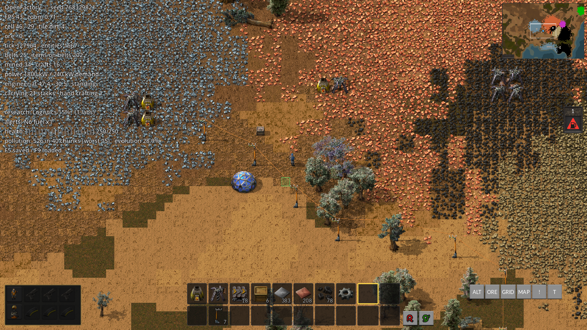
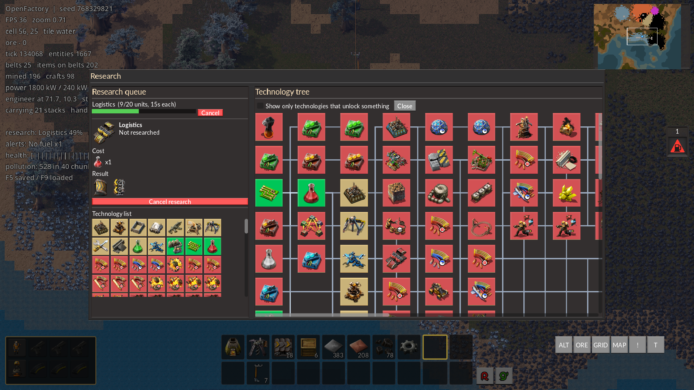
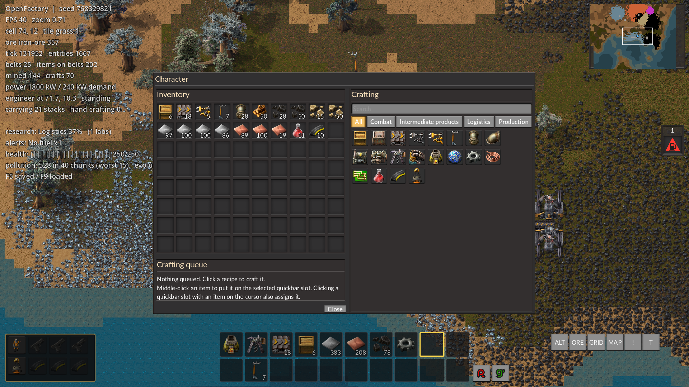
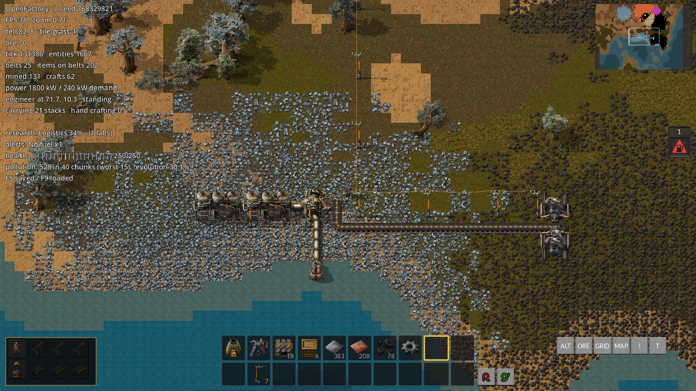
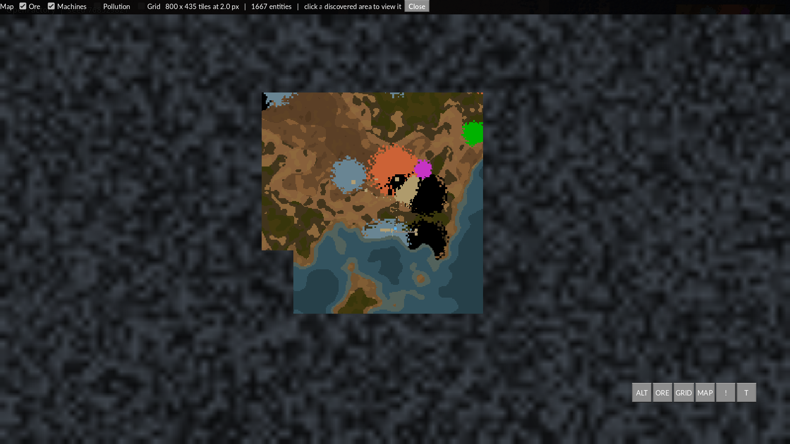

# OpenFactory

**Клон Factorio на Godot 4.7.** Мир, прототипы, рецепты, технологии, звуки и
графика читаются из локальной установки Factorio 2.0.77 — в репозитории нет ни
одного ассета игры, только код и извлечённые JSON-описания прототипов.

Проект — не «демка на один экран», а довольно полная симуляция завода:
генерация бесконечного мира, конвейеры и вставщики, печи и сборочные машины,
энергосети, жидкости, логистические роботы, поезда, схемы, загрязнение, битвы,
исследования, ручное крафт-меню, сохранения и интерфейс в стиле оригинала.

## Скриншоты

<table align="center">
<tr>
<td align="center"><a href="screenshots/1.png"></a><br><sub><b>1</b></sub></td>
<td align="center"><a href="screenshots/2.png"></a><br><sub><b>2</b></sub></td>
<td align="center"><a href="screenshots/3.png"></a><br><sub><b>3</b></sub></td>
</tr>
<tr>
<td align="center"><a href="screenshots/4.png"></a><br><sub><b>4</b></sub></td>
<td align="center"><a href="screenshots/5.png"></a><br><sub><b>5</b></sub></td>
<td></td>
</tr>
</table>

---

## Быстрый старт

1. Установите **Godot 4.7** (проект собран под 4.7.2, Forward+).
2. Установите **Factorio 2.0.77** (Steam/GOG/standalone).
3. Проверьте путь к игре в `project.godot`:

   ```ini
   [openfactory]
   factorio_root="/home/cha14ka/.steam/steam/steamapps/common/Factorio"
   ```

   Если игра лежит в другом месте — поменяйте значение.
4. Откройте папку проекта в Godot и нажмите **F5** (Play).
   Главная сцена — `res://scenes/main.tscn`.

При первом запуске читаются `assets/data/manifest.json`, ~3900 прототипов и
таблицы локализации; это занимает пару секунд.

---

## Сборка в один `.exe` с ресурсами Factorio

В обычном запуске игра читает `data/base` и `data/core` из установленного
Factorio по абсолютному пути. Для переносимой сборки эти файлы нужно
упаковать внутрь `.exe`:

1. Установите **Godot 4.7.2** с Windows export templates
   (**Editor → Manage Export Templates**).
2. Подготовьте ресурсы (нужен установленный Factorio 2.0):

   ```bash
   python3 tools/prepare_export_data.py --force
   ```

   Скрипт создаёт `factorio_data/data/{base,core,elevated-rails,quality}`.
   Крупные PNG/OGG/шрифты переименовываются в `*.bin`, чтобы Godot не
   импортировал полтора гигабайта картинок как ресурсы; игра читает их из PCK
   через `FileAccess`.
3. Соберите Windows-исполняемый файл:

   ```bash
   godot --headless --path . --export-release "Windows Desktop" build/OpenFactory.exe
   ```

   Или одной командой:

   ```bash
   ./tools/build_windows.sh
   ```

В `export_presets.cfg` включён **Embed PCK**, поэтому рядом не нужен
отдельный `.pck` — получается один `build/OpenFactory.exe`.

### Linux

```bash
./tools/build_linux.sh
```

Результат — один исполняемый файл `build/OpenFactory.x86_64` (PCK встроен).
Скрипт сам ставит ему executable-бит. Внутрь попадают PNG/OGG и три
используемых шрифта Lato; Lua-исходники Factorio, шейдеры, документация,
zip-банки звуков и неиспользуемые CJK-шрифты отфильтрованы. Сборка идёт из
чистой временной копии проекта, поэтому `tmp_preview/`, `tools/`, `build/`
и MCP-плагин в бинарник не попадают.

Проверочный размер Linux-сборки — **1.5 ГБ**, это меньше Windows-сборки
(1.7 ГБ); внутри ровно один ELF-файл без внешнего `.pck`.

### Android

```bash
./tools/build_android.sh
adb install --no-incremental -r -d build/OpenFactory-debug.apk
```

Debug APK содержит те же ресурсы Factorio, но собирается из чистой staging-копии
и не тащит `tmp_preview`, `tools` или MCP-плагин. В preset включены
`INTERNET`/`ACCESS_NETWORK_STATE`, чтобы APK мог подключаться к Godot remote
debugger. Проверка интерфейса велась на Redmi Note 8 через scrcpy/ADB-снимки.

### Web (WebAssembly)

```bash
./tools/build_web.sh                     # build only
./tools/build_web.sh --png8              # palette PNG compression (PCK меньше)
./tools/build_web.sh --png8 --png8-colors 128
./tools/build_web.sh --serve 8080        # build, then serve for testing
```

### Сжатие текстур

Для Web используется **PNG8** (индексированный PNG): картинка остаётся
того же размера, но палитра сокращается до 256 (или `--png8-colors N`)
цветов. Godot Web шаблон **не декодирует WebP** — если собрать Web с
`--webp`, все текстуры будут отсутствовать (`Assets: could not decode ...`).
Старый флаг `--webp` в `build_web.sh` теперь автоматически переключается на
PNG8.

Файлы по-прежнему называются `.png.bin`. Godot импортирует всё, что лежит в
`res://` с расширением `.png`, в `.ctex` и теряет исходный файл, а игре нужны
ровно байты Factorio. `.bin` делает файл «непонятным» для импортёра;
`factorio_data` дополнительно закрыт `.gdignore`, а
`FactorioAssets.packed_file()` сначала ищет точный путь, затем `path + ".bin"`.
Исходное `.png` в имени сохраняется, потому что на него ссылаются прототипы.
PNG8 остаётся обычным PNG, поэтому дополнительная магия не нужна.

Скрипт печатает прогресс (`файлы/всего`, проценты, скорость, ETA) и умеет
продолжать с места остановки: уже готовые файлы пропускаются. `--clean`
удаляет staging и собирает заново. Если старый staging был в WebP, PNG8-режим
переконвертирует такие файлы.

Конвертация идёт параллельно (по умолчанию до 8 потоков), файлы пишутся
атомарно через `.tmp`, поэтому Ctrl+C не оставит «половину» файла.
`--jobs N` задаёт число потоков. Для текущей 40-минутной сборки: останови
её, запусти `./tools/build_web.sh --png8` заново — уже сконвертированные
файлы будут пропущены, а прогресс покажет, сколько осталось.

Уменьшать именно размеры картинок в 2 раза «в лоб» нельзя: Factorio-спрайты
нарезаются по `width/height` из прототипов. Для честного 2× downscale нужно
переписать эти поля и `shift/scale` во всех JSON-прототипах — иначе кадры
поедут. Практичный компромисс для Web — PNG8 с меньшим числом цветов.

Результат — `build/web/` с `index.html`, `index.js`, `index.wasm`, `index.pck`
и аудио-worklet'ами. Запускать нужно **по HTTP**:

```bash
(cd build/web && python3 -m http.server 8080)
```

и открыть `http://localhost:8080/`. Открытие `index.html` через `file://` не
сработает: браузер не загрузит `.wasm`/`.pck`.

Скрипт собирает из чистой staging-копии, вырезает MCP-плагин и `tools/`,
`tmp_preview/`, `build/`; для web принудительно включает **Compatibility
renderer** (`rendering/renderer/rendering_method.web`), иначе Forward+ не
запускается в браузере. Threads выключены, поэтому COOP/COEP-заголовки не
нужны — подходит любой статический хостинг.

Проверка: собранный `build/web` открыт в headless Chromium, загрузился
экран OpenFactory с миром и меню. Размер PCK ~1.4 ГБ из-за ресурсов
Factorio; первый запуск по сети будет долгим, локально — быстро.

Если шаблонов web export templates нет, `build_web.sh` завершится с ошибкой
экспорта, а не оставит пустой `build/web`.

Важно:

- Размер готового файла будет порядка **1.5 ГБ**: внутри лежат спрайты, звуки
  и шрифты Factorio. DLC `space-age` не включается — проект использует
  base/core плюс небольшие elevated-rails/quality.
- На машине, где запускается сборка, Factorio уже не нужен: игра сначала
  ищет `res://factorio_data/packed_data.marker`, затем использует упакованные
  данные.
- Для запуска сборки на Windows нужен x86_64; экспорт с Linux тоже работает,
  если установлены шаблоны Windows.
- **Не распространяйте такой `.exe` без разрешения Wube:** ресурсы Factorio
  не входят в лицензию кода проекта.

---

## Управление

| Действие | Клавиша / мышь |
|---|---|
| Движение | `WASD` / стрелки |
| Приблизить/отдалить | колесо мыши |
| Поставить предмет | ЛКМ по земле |
| Добыть вручную | удерживать ПКМ |
| Повернуть предмет | `R` (превью поворачивается вместе с ним) |
| Выбрать предмет под курсором | `Q` |
| Вернуть предмет с курсора / очистить | `ПКМ` или `Q` |
| Провод: взять/убрать | кнопки `R`/`G` справа от панели; `Ctrl+W` — цикл |
| Убрать провод | `ПКМ`, `Esc` или повторный клик по кнопке |
| Очистить ячейку панели | средняя кнопка мыши по ячейке |
| Ставить линию объектов | ЛКМ зажать и вести мышь |
| Поднять предметы рядом | `F` |
| Бросить предмет из рук под курсор | `Z` |
| Слоты быстрой панели | `1`…`9`, `0`; `Shift`+цифра — второй ряд |
| Инвентарь / крафт | `E` |
| Экипировка | `G` |
| Карта | `M` |
| Исследования | `T` |
| Производство | `P` |
| ALT-оверлей | `Alt` |
| Сохранить / загрузить | `F5` / `F9` |
| Пауза / меню | `Esc` |
| Вернуть камеру на инженера | `Home` |

### Телефон/планшет

Постоянно на экране только джойстик и пять кнопок; остальное спрятано в
**MORE**, чтобы не занимать пол-экрана. Щипковый зум меняет только масштаб и
не отвязывает камеру от инженера; отвязать её можно осознанным сдвигом
камеры одним пальцем или кликом по карте.

| Действие | Жест |
|---|---|
| Движение | большой левый джойстик **MOVE** |
| Курсор/прицел | правый джойстик **AIM** |
| ЛКМ / ПКМ | кнопки **LMB** / **RMB** над левым джойстиком |
| Поставить предмет на землю | короткий тап по миру |
| Подобрать предмет с земли | **двойной тап** по нему |
| Открыть машину, сундук или другое сооружение | **двойной тап** по нему |
| Добыть руду или сломать машину | удерживать палец на цели |
| Провести линию конвейеров | зажать палец с предметом в руке и вести |
| Осмотреть карту | провести пальцем по пустому месту (рука пустая) |
| Приблизить / отдалить | щипок двумя пальцами или `+`/`−` в MORE |
| Сдвинуть камеру | провести одним пальцем по пустому месту |
| Повернуть предмет / машину | **ROT** |
| Выстрелить по ближайшей цели | **FIRE** |
| Инвентарь / исследования | **INV** / **TECH** |

**MORE** открывает компактную сетку: карта, экипировка, производство,
транспорт, подобрать, убрать, провод, ALT, руда, сетка, алерты, домой,
сохранить, загрузить, пауза и масштаб.

На touch-устройстве обычные кнопки интерфейса увеличены, а **Close / Back**
получают минимальный размер **150×64 px** (на экране телефона — ещё крупнее
из-за масштабирования), чтобы окно было легко закрыть пальцем. Правые кнопки
отодвинуты от края на **56 px**, чтобы не попадать в скруглённые рамки
телефонов; джойстик **MOVE** увеличен до **232 px**. Оба джойстика подписаны
**MOVE** и **AIM**.

### Быстрая панель (2 ряда по 10 слотов)

- ЛКМ по слоту — выбрать его.
- Если на курсоре есть предмет (взят из инвентаря или машины), ЛКМ по слоту
  **кладёт этот предмет в слот**, ничего не расходуя.
- ПКМ по слоту — очистить слот.
- Средний клик по предмету в инвентаре — положить его в выбранный слот.
- Предмет, взятый на курсор, можно нести из инвентаря прямо в мир: после
  закрытия окна он остаётся на курсоре, рисуется поверх HUD и ставится ЛКМ.

---

## Что внутри

```
src/
  core/      Prototypes, Defs, Loc, FactorioAssets, FactorioStyle,
             FactorioAudio, SpriteSource
  world/     GameWorld (чанки 32×32, сущности), MapGenerator, Entity,
             TileAtlas, DayCycle, RailGeometry, NoiseExpression/NoiseBasis
  sim/       Simulation (60 Гц), BeltSim, FluidSystem, PowerNetwork, Energy,
             LogisticNetwork, Trains, CircuitNetwork, Inventory,
             InventoryLayout, Research, Objectives, Pollution, Alerts,
             Statistics, Modifiers, EquipmentGrid, SaveGame, Blueprints
  render/    WorldRenderer, EntityVisuals, SpriteCache, MapChunks
  player/    Player (строительство, крафт, стрельба, быстрая панель),
             Character (движение/майнинг/анимации), GameCamera
  ui/        MainMenu, PauseMenu, InventoryWindow, EntityWindow,
             ResearchWindow, ProductionWindow, EquipmentWindow, MapWindow,
             Minimap, Toolbar, TooltipLayer, AlertPanel, ObjectivePanel,
             VictoryScreen, ItemSlot, UiKit, FactorioStyle
  game.gd    bootstrap: мир → рендер → камера → игрок → HUD → меню
tools/       извлечение данных из Factorio и офлайн-превью (Python)
assets/data/ manifest, прототипы (246 типов, 3943 прототипа), локали en/ru
```

Ключевые идеи:

- **Данные — из Factorio.** `tools/factorio_extract/convert.py` превращает
  `data.raw` в JSON; игра ничего не хардкодит про рецепты, спрайты и звуки.
- **Мир чанковый.** `GameWorld` генерирует 32×32 чанка процедурно и кэширует их;
  руда лежит в отдельных байтовых массивах на клетку.
- **Симуляция фиксированная, 60 Гц.** Рендер может быть любым, но завод всегда
  тикает с одной скоростью.
- **Один проход отрисовки.** `WorldRenderer` собирает список прямоугольников
  (тайлы, руда, сущности, поезда, роботы, предметы на конвейерах) и рисует его
  одним `_draw`, а не тысячами нод.
- **Реальный интерфейс.** `FactorioStyle` собирает `Theme` из
  `gui-style.json`: 9-slice рамки, шрифты Lato, цвета состояний.

---

## Исправленные баги

Ниже — то, что было найдено и исправлено. Всё проверялось **запуском игры из
редактора Godot** (без headless-прогонов).

### 1. Инженер невидим, конвейеры рисуются «не теми» кадрами

`SpriteSource` заворачивал кадр спрайта в `AtlasTexture` с регионом и при этом
отдавал тот же регион как `src_rect`. `draw_texture_rect_region` применял
смещение региона дважды: спрайт сэмплировался из `region + src_rect`.

У инженера idle-лист начинается с `y = 464`, удвоенное смещение уходило за
пределы текстуры — персонаж был полностью прозрачным. У конвейеров так же
съезжали строки, поэтому вместо ленты рисовались чужие кадры.

Исправление: слой хранит **полный лист** и `src_rect`, без `AtlasTexture`.
Дополнительно у конвейера выставлен `is_row = true` (двадцать строк листа —
это формы ленты, а не повороты), а таблица прямых участков исправлена на
`row 0 = восток, 1 = запад, 2 = север, 3 = юг`.

### 2. Пустое меню без кнопок

В текущей сборке пустое меню не воспроизвелось (кнопки строились и были
кликабельны), но причина была устранена на уровне раскладки: `UiKit.fill_parent`
раньше задавал только `size` и полагался на событие resize, которого при старте
может не быть — тогда `CenterContainer` оставался нулевого размера и колонка
уезжала за экран. Теперь `fill_parent` ставит полноэкранные якоря (а в headless-режиме ещё и
явный размер), и `MainMenu.open()` принудительно перекладывает контейнеры. HUD (быстрая панель,
тулбар, цели) на титульном экране скрыт, чтобы не перекрывать меню.

### 3. `R` не поворачивал предмет

После починки спрайтов превью постройки стало видимым и действительно
поворачивается. Превью теперь строится из **предмета на курсоре**, если он там
есть, иначе из выбранного слота панели, и использует актуальный
`build_direction`.

### 4. Нижняя панель была нередактируемой

Быстрая панель стала настоящей панелью Factorio: **2 ряда × 10 слотов**.
Слоты кликабельны: ЛКМ с предметом на курсоре назначает предмет, ПКМ очищает,
средний клик по предмету в инвентаре кладёт его в выбранный слот. Старые
сохранения с 8 слотами при загрузке дополняются до 20.

### 5. Нельзя было поставить предмет, взятый из инвентаря

Раньше закрытие инвентаря возвращало предмет обратно, а строительство смотрело
только на быструю панель. Теперь:

- предмет на курсоре остаётся на курсоре после закрытия окна;
- поверх HUD рисуется иконка предмета и количество;
- `build_at_cursor()` / призраки / поезда / превью используют `held_item()`
  (курсор → панель);
- при постройке расходуется именно тот предмет, из которого строили.

### 6. Конвейеры не было видно при установке

Следствие бага №1: конвейер рисовался кадром из неправильного места листа, а
для многих направлений — вообще за пределами атласа. После исправления
`AtlasTexture + is_row` лента рисуется корректно для всех направлений и
поворотов.

### 7. Производительность: 30 FPS и постоянные подвисания

Замеры до исправлений (окно 1600×900, пустой мир):

| Что | Было |
|---|---|
| Сборка списка отрисовки | **~16.4 мс каждый кадр** |
| Перестройка миникарты (34 000 клеток) | **~107 мс каждые 20 кадров** |
| Генерация одного чанка | **~145 мс** |
| FPS | ~30–50 с рывками |

Что сделано:

- **Кэш земли в рендерере.** Тайлы и руда кэшируются по клетке и сбрасываются
  только при изменении мира/шага анимации воды. Сборка списка — **~1.2 мс**.
- **Тег для спрайтов руды.** `SpriteCache` больше не строит структурный
  «отпечаток» всего дерева `stages` для каждой клетки руды.
- **Грубая выборка шумовых выражений.** Температура и `aux` считаются на сетке
  с шагом 16 клеток и билинейно интерполируются вместо запуска VM Factorio на
  каждую клетку. Генерация чанка — **~10 мс**.
- **Миникарта на чанках.** `MapChunks` держит 32×32 текстуры чанков; миникарта
  рисует их, а не пересчитывает 34 000 клеток. Перестройка — практически
  бесплатная, обновление каждый кадр.
- **Карта на тех же чанках.** Полноэкранная карта собирается из кэша и
  перестраивается только при изменении мира/зума/панорамы (**~5.5 мс**), причём
  не генерирует неисследованные чанки (они остаются тёмными).
- **Общий кэш чанков** для миникарты и карты.
- **HUD и позиционный звук — 10 Гц**, а не 60: они обходят весь список сущностей.
- **Корректный слой ночи** (`CanvasLayer` 1, под интерфейсом) и блокировка
  ввода под меню/паузой.

После: **60 FPS** в окне 1600×900, без периодических 100-мс фризов.
Чанк всё ещё генерируется ~10 мс — это разовый рывок при входе в новую
территорию, а не постоянные подвисания.

### 8. Метка игрока на карте и миникарте

- На миникарте появилась синяя точка инженера с тёмной обводкой.
- На полной карте — синий маркер-оверлей, который остаётся видимым при
  панорамировании и не заставляет перестраивать всё изображение при каждом шаге.
- Карта при открытии центрируется на инженере (раньше она открывалась
  смещённой: `centre_on()` читал размер `TextureRect` до первой раскладки и
  получал минимальные 640×480 вместо реального размера окна).

### 9. Инженер спавнился внутри солнечных панелей

`_spawn_cell` выбирался в `_build_starter_factory()` **до** того, как ставились
солнечные панели и столбы, и проверял только одну клетку. Панели 3×3 накрывали
эту клетку позже, а `Character.blocked()` считал занятыми все четыре угла — игрок
не мог шагнуть ни в одну сторону.

Теперь клетка спавна выбирается в конце постройки: `_find_spawn_cell()` ищет
площадку 3×3 без сущностей и воды, а `_ensure_character_free()` дополнительно
выталкивает инженера из занятой клетки при старте, загрузке сохранения,
возрождении и новой игре. На всякий случай `Character.tick()` разрешает
движение, если персонаж уже стоит внутри объекта, чтобы из такого состояния
можно было выйти вручную.

### 10. «Не могу поставить объект»

Две причины:

- окно инвентаря было полноэкранным `MOUSE_FILTER_STOP` и **съедало клики по
  миру**; теперь прозрачная подложка пропускает мышь, а `Player` при открытом
  инвентаре принимает клики по миру (клавиатура и движение по-прежнему
  блокируются, чтобы поиск в крафте не двигал персонажа). Проверено реальным
  `Viewport.push_input()`, а не только вызовом метода;
- при неудачной установке (занятый футпринт, дерево, вода) теперь играет
  `cannot_build`, а превью заранее краснеет.

### 11. У манипуляторов не было руки

`EntityVisuals` для типа `inserter` возвращал только `platform_picture` и
выходил из цикла — `hand_base_picture` не рисовался никогда. Теперь:

- платформа выбирается из четырёх кадров листа по направлению (раньше всегда
  брался северный кадр);
- рука рисуется как линия от центра к кисти и настоящий спрайт
  `hand_open/hand_closed`, который **поворачивается по дуге** от клетки забора
  к клетке выгрузки по `state["swing"]`;
- в кисти рисуется иконка предмета, если манипулятор что-то несёт;
- призрачные манипуляторы тонируются синим.

При наведении на манипулятор поверх мира рисуются направляющие: синяя линия и
рамка клетки забора, оранжевая стрелка с наконечником и рамка клетки выгрузки.

### 12. Манипулятор клал в машину что попало

`_can_insert()` проверял только наличие места. Добавлена `_accepts_input()`:
фургон/сундук/машина принимают что угодно, а печь — только топливо или
ингредиент плавки, сборочная машина — только ингредиент своего рецепта (или
любого рецепта своих категорий, пока рецепт не выбран), лаборатория — только
научные пакеты, турель — только подходящие боеприпасы, кузня/реактор — топливо,
маяк — модули. Ингредиенты категорий кэшируются, поэтому проверка не стоит
ничего на каждом тике.

### 13. Конвейеры не анимировались, предметы были под лентой

- Кадр анимации ленты теперь считается из `simulation.tick`, `speed`
  прототипа и `frame_count` листа; жёлтая, красная и синяя ленты крутятся с
  разной скоростью. Это работает и для splitter/underground-belt.
- Предметы на ленте сортировались по своей lane-координате и на ближней полосе
  оказывались **под** спрайтом ленты — отсюда «что-то мелькает». Теперь предмет
  сортируется чуть выше центра своей клетки и всегда рисуется поверх ленты;
  учитываются и splitter/underground, а не только transport-belt.
- В `_draw` добавлена отрисовка линейных записей — заодно стали видны провода
  схем, которые раньше попадали в draw-list, но пропускались как «без
  текстуры».

### 14. Ночь накрывала интерфейс, не было фонарика

`hud` (дебаг-текст и панель целей) был на `CanvasLayer` 0, поэтому ночной слой
(1) затемнял его. Теперь HUD — слой 2, быстрая панель — 2, окна — 3, а ночь —
1: ночь ложится только на мир и инженера.

Добавлен шейдер `src/render/night_flashlight.gdshader`: из ночной заливки
вырезается мягкий круг вокруг инженера, радиус масштабируется с зумом. Это и
есть фонарик — мир вокруг игрока виден, интерфейс не затрагивается.

### 15. Правила постановки: буры только на руде, всё остальное — на земле

Добавлена `GameWorld.can_place_terrain()` и она используется в постановке
игроком, в превью и в чертежах:

- **электрический и простой (burner) бур** ставится только если под его
  футпринтом есть подходящая руда (`resource_categories`, например
  `basic-solid`). На пустой траве/песке — отказ и звук `cannot_build`;
- **всё остальное** можно ставить без ограничений по типу земли — на траве, на
  руде, в пустоте;
- **на воде** нельзя ставить ничего (ни машины, ни трубы), проверяются
  `water`, `water-shallow`, `deepwater` и их варианты;
- **засыпка (landfill)** — исключение: это предмет с `place_as_tile`, он
  заменяет воду на `landfill`, если текущий тайл входит в его
  `tile_condition`. Для неё добавлена отдельная постановка тайла
  (`_build_tile`) и отрисовка `material_background` в `TileAtlas` (иначе
  засыпка была бы валидной, но невидимой).

Призраки (ghosts) и чертежи без материалов по-прежнему разрешены где угодно —
это планы, а не постройки. `Blueprints.place()` при нехватке грунта оставляет
призрак, а не строит машину.

### 16. Каждое нажатие `W` включало провод и блокировало строительство

Настоящая причина «объекты не ставятся, надо тыкать много раз»: `W` была
одновременно **движением вперёд** и **переключением провода**
(красный → зелёный → выключен). Обычный шаг вверх случайно вооружал
инструмент провода, после чего ЛКМ рисовала провод вместо установки объекта.
Ещё одно `W` переключало цвет, третье — выключало, и строительство снова
работало «на короткое время» — ровно тот симптом, который был описан.

Теперь:

- `W` — только движение;
- провод берётся **кнопками с иконками красного/зелёного провода справа от
  панели вещей** (как shortcut bar в Factorio); клик по кнопке берёт провод,
  повторный — убирает;
- активная кнопка подсвечивается зелёным, в HUD пишется `wire: red/green ...`;
- `Ctrl+W` остался быстрым циклом: красный → зелёный → выключен;
- `ПКМ` и `Esc` убирают провод;
- без активного провода клик по печи открывает её окно, а не рисует провод.

Проверено: после `W` `wire_colour` пуст и печь ставится; клик по печи при
выключенном проводе открывает инвентарь печи; при активном проводе — тянет
провод; после отмены провод снова открывается инвентарь.

### 17. Ходьба по конвейерам, радиус столбов и медные провода

- Конвейеры, электрические столбы и манипуляторы больше не считаются стенами:
  `Character._blocks()` пропускает `transport-belt`, `underground-belt`,
  `splitter`, `inserter` и все варианты `electric-pole`.
- Если инженер стоит на конвейере, лента сама везёт его в своём направлении
  со скоростью `speed` прототипа: 0.03125 tile/tick у жёлтой, 0.0625 у красной,
  0.09375 у синей. Это та же скорость, с которой движутся предметы на ленте.
  В паузе/меню лента не двигает игрока.
- При наведении на столб рисуются: зелёный квадрат supply area и оранжевый
  круг `maximum_wire_distance` — дальность, на которой столб соединяется
  медным проводом с другим столбом.
- `PowerNetwork` теперь хранит `links` — пары соединённых столбов. Рендерер
  рисует по ним медные провода от реальных `connection_points` на верхушках
  столбов. Логика сети и картинка используют один и тот же список, поэтому
  провод не может появиться без электрического соединения и наоборот.

### 18. Буры: поворот через R и сторона выдачи руды

- `R` над уже поставленным **поворачиваемым объектом** поворачивает сам
  объект, а не только `build_direction`; если под курсором такого объекта
  нет — как раньше, крутится предмет для постановки. Это работает для буров,
  лент, манипуляторов и других машин.
- При наведении на бур рисуется жёлтая стрелка в клетку выдачи — сторона
  видна до включения питания.
- Выдача стала настоящей: `_update_miner()` считает мировую клетку по
  `vector_to_place_result`, повёрнутому на `direction`. Если там стоит
  конвейер (transport/underground/splitter), руда кладётся прямо на него;
  если клетка пустая — на землю кладётся `item-on-ground` (его можно поднять
  кликом, `Q` или вставщиком); только если клетка занята/вода — в выходной
  инвентарь бура.
- Электрические буры стартового завода теперь ставятся с `direction = 8`
  (юг): выход смотрит на вставщик и ленту, а не в обратную сторону.

Проверено: у стартовых буров `direction = 8`, `R` меняет его на 12 и выходная
клетка уезжает на запад; burner-бур с выходом на ленту кладёт предмет в
`BeltSim` (1 предмет на ленте), а его внутренний output остаётся пустым.
Скриншот со стрелкой — `tmp_preview/drill_output.png`.

### 19. Буры сбрасывают добычу перед собой

- Выходная клетка считается из `vector_to_place_result` и поворота бура.
- Если впереди лента — предмет сразу на ленте; если земля — создаётся
  `item-on-ground` со своей иконкой и количеством; если клетка занята или
  вода — используется выходной инвентарь.
- Наземные предметы можно поднять кликом, `Q` или `ПКМ`; вставщики тоже
  умеют брать их из `item-entity`.

### 20. Q в руки, призрак при отсутствии и выбор предмета для панели

- `Q` над объектом/предметом на земле **берёт предмет в руки** (переносит из
  инвентаря или с земли), а не просто выбирает слот.
- Если в руках уже что-то есть, `Q` **очищает руку** в любом месте, даже если
  курсор вне мира; при пустой руке `Q` по пустой земле ничего не делает.
- Если такого предмета у игрока нет, `Q` всё равно даёт его в руки с
  количеством 0; следующий клик ставит **призрак**.
- То же для нижней панели: если выбранный предмет отсутствует в инвентаре,
  клик по земле ставит призрак (превью при этом синее).
- Клик по **пустой ячейке панели** открывает окно выбора всех предметов,
  открытых текущими исследованиями (плюс всё, что уже есть в инвентаре), с
  поиском и иконками. Выбранный предмет записывается в эту ячейку.

### 21. Значок отсутствия электричества

Над электрическим устройством без питания (вставщик, электрический бур,
сборочная машина и т.п.) рисуется красный значок `electricity-icon-red.png`
из Factorio. Проверка идёт через `PowerNetwork.satisfaction_for()`, поэтому
значок пропадает, как только появляется питание.

### 22. Анимация электрического бура

- У электрического бура базовая картинка статична, а движение головы и
  выдача руды лежат в `graphics_set.working_visualisations`.
- `EntityVisuals` теперь добавляет к базе `always_draw`-визуализации, у
  которых есть кадры; `WorldRenderer` передаёт им реальный animation frame
  (0.4 кадра/тик, 60-кадровый цикл), а не жёсткий 0.
- Заодно оживают анимации burner-бура, печей и сборочных машин: их листы
  тоже используют `frame_count`.
- Проверено: у головы бура и выходного лотка меняется `src_rect` между
  кадрами; два снимка через 8 кадров отличаются; FPS 60.

### 23. Сортировка предметов по типу

- `Prototypes.item_sort_key()` собирает ключ `group order / subgroup order /
  item order / name` из `item-group`, `item-subgroup` и самого предмета.
- Инвентарь персонажа сортируется этим ключом при каждом обновлении окна:
  логистика, производство, промежуточные продукты, сырьё и т.д. идут
  группами, а не в порядке подбора.
- Тот же ключ используют список крафта (`craftable_recipes()`) и окно выбора
  предмета для панели (`ItemPicker`), поэтому все три списка сортируются
  одинаково.
- Сортируется только инвентарь персонажа; сундуки и слоты машин сохраняют
  свой порядок.

Проверено: ключи инвентаря, крафта и выбора панели монотонно возрастают;
скриншот `tmp_preview/inventory_sorted.png`.

### 24. Деревья и камни, и запрет спавна на воде

- `MapGenerator._spawn_decoratives()` заполняет каждый новый чанк деревьями
  (`tree-01`…`tree-09`, сухие варианты для песка/пустыни) и камнями
  (`big-rock`, `huge-rock`, `big-sand-rock`).
- Лесные пятна задаёт отдельный шум `_forest`: в лесу деревья идут плотно,
  вне него — редкие одиночные. Камни распределены по суше.
- Каждая клетка будущего дерева/камня проверяется: не вода, не руда, не
  занята другим объектом. Объекты, выходящие за границу чанка, не ставятся,
  чтобы генерация не рекурсировала.
- `GameWorld.place_entity()` теперь вообще не принимает физический объект ни
  на одной водной клетке (ghost — исключение, это план). Стартовая фабрика
  ищет площадку только на суше, а деревья/камни в её пятне вычищаются перед
  постройкой.
- Деревья при добыче дают дерево, камни — камень/уголь, по `minable` из
  прототипа.

Проверено: в новом мире обнаружено больше 1500 деревьев и около 90 камней,
ни одного на воде или глубокой воде; стартовая фабрика снова ставит все
33 объекта; генерация чанка — 8–24 мс (лесной чанк дольше), вне леса FPS
снова ~60, в очень плотном лесу около 48 из-за количества крупных спрайтов.
Скриншот `tmp_preview/forest.png`.

### 25. F — поднять рядом, Z — бросить под курсор

- `F` собирает в инвентарь наземные стопки `item-entity` и предметы с лент
  в радиусе 4.5 тайла вокруг инженера. Если в инвентаре нет места, остаток
  остаётся на земле/ленте.
- `Z` бросает предмет из рук в клетку под курсором: на землю создаётся
  `item-on-ground`, на ленту предмет кладётся через `BeltSim.try_insert`.
  На воду и занятые чужие клетки бросок запрещён.
- При разрушении ленты (в том числе ручной добычей) всё, что ехало на ней,
  переходит в инвентарь через сигнал `mined`; сама лента тоже попадает туда.

Проверено: `Z` бросил 10 лент на землю, `F` поднял их (+10 в инвентаре);
`Z` на ленту положил 5 угля, `F` снял их с ленты; после поломки ленты 5 угля
перешли в инвентарь, лента исчезла. FPS 60.

### 26. Исправлен дюп предметов при возврате из рук

- `Inventory.insert()` возвращает **остаток**, а не количество, которое
  поместилось. В `InventoryWindow._transfer()` и `EntityWindow` этот остаток
  вычитался из размера стака как «вставленное» число. Из-за этого курсор
  оставался полным, хотя предмет уже лежал в инвентаре — каждый следующий
  клик добавлял ещё столько же.
- Теперь считается `inserted = amount - leftover`, и курсор уменьшается
  ровно на то, что реально попало в слот.
- Заодно исправлен правый клик в окне машины: он уменьшает руку только
  тогда, когда предмет действительно вставился.

Проверено: 20 меди в руках → клик по пустой ячейке: в инвентаре 20, в руках
пусто; повторные клики по пустым ячейкам оставляют 20, а не 40/60/80.

### 27. Спрайт дерева: стадии по загрязнению, а не анимация

- У Factorio листы `tree-*-normal.png` — это normal map, а не крона. Раньше
  он рисовался вместе с деревом, а общий animation frame перебирал три кадра
  `leaves`/`normal` (0..2), поэтому дерево бесконечно мигало между полным и
  «лысым».
- Теперь рисуются `trunk` + `leaves` + `shadow`; normal map не используется.
- Кадр листвы выбирается как **стадия**: 0 — полная, 1 — поредевшая, 2 —
  почти голая. Стадия зависит от загрязнения чанка (50/300 единиц) и здоровья
  дерева, а не от времени, поэтому спрайт не переключается каждый кадр.
- Сухие/мёртвые деревья берут один вариант из `pictures`, а не все сразу.

Проверено: `src_rect` листвы стабилен между тиками; при загрязнении
0 / 60 / 400 стадии 0 / 1 / 2. Скриншот `tmp_preview/tree_fixed.png`.

### 28. Culling и LOD при отдалении камеры

- Причина просадки: при `zoom 0.5` в кадр попадало около 8 400 текстурированных
  прямоугольников — почти всё это были отдельные клетки земли и сотни деревьев.
- Теперь при `_render_scale <= 0.70` земля рисуется не по клеткам, а готовыми
  цветными текстурами чанков `MapChunks` (32×32). Несгенерированные чанки
  остаются тёмными и не генерируются в кадре.
- Деревья и камни теперь рисуются при любом зуме: сцена не должна терять
  лес и камни только из-за отдаления камеры. Ниже `_render_scale < 0.65`
  включается LOD: каждый объект рисуется одним кэшированным quad (крона
  дерева или картинка камня), без trunk/shadow слоёв. Ниже `< 0.45` весь
  лес и камни чанка запекаются в одну прозрачную текстуру 256×256, поэтому
  кадр получает один quad на чанк вместо сотен деревьев. Кэш перестраивается
  по `decor_revision` (установка/удаление сущностей), а не по добыче руды,
  иначе лес перепекался бы каждый тик. Лежащие на земле предметы
  по-прежнему скрываются при `< 0.65`, мелкие вставщики/столбы/трубы — при
  `< 0.22`, предметы на лентах — при `< 0.25`. Машины, ленты и сам инженер
  остаются.
- Всё, что вне камеры, по-прежнему отсекается по `visible_world_rect()`, а
  симуляция продолжает тикать независимо от рендера.

Проверено на загруженном сохранении `main` (1678 сущностей): zoom 0.25 —
**80 FPS** (было 10), 337 предметов / 346 draw calls; zoom 0.35 — 74 FPS.
Отсечение лежащих предметов и мелких деталей осталось. Скриншот
`tmp_preview/zoom_025_baked_trees2.png`.

### 29. Рабочие визуализации машин (печь, огонь, блики)

- Factorio хранит огонь печи, нагреватели электрической печи, дым бура и
  пропеллеры в `graphics_set.working_visualisations`, а не в базовой
  `animation`.
- `EntityVisuals` теперь собирает этот список **для любого прототипа**:
  `always_draw`-части идут в обычные узлы, остальные — в `working_nodes`.
  Рендерер показывает `working_nodes` только когда
  `entity.state.progress > 0`, то есть машина действительно плавит/крафтит.
- Текстуры с `draw_as_light` и `blend_mode: additive` — это маски света.
  Один batched-canvas не может включить additive-блендинг на отдельный
  прямоугольник, поэтому такие слои теперь пропускаются: раньше полностью
  непрозрачная light-текстура рисовалась поверх печи и превращала её в
  чёрный прямоугольник.
- Базовая текстура печи и прозрачный огонь остаются видимыми.

Проверено: у плавящейся каменной печи рисуются `stone-furnace.png` и
`stone-furnace-fire.png`, а `stone-furnace-light.png`/`ground-light.png`
больше не перекрывают её. В простое огня нет. Скриншот
`tmp_preview/furnace_smelting2_crop.png`.

### 30. Настройки мира при одиночной игре

«Single player» в главном меню теперь открывает окно настроек, а не сразу
создаёт карту. После «Start game» параметры применяются к генератору и
сохраняются вместе с игрой.

- **Map**: вода (`water`) и влажность/сухость (`moisture`). Чем суше, тем
  меньше деревьев; параметр одновременно задаёт `generator.tree_density`.
- **Ore**: для каждой руды (железо, медь, уголь, камень, уран, нефть) —
  frequency / size / richness. Частота уменьшает расстояние между патчами,
  размер меняет радиус, богатство — запас руды и её стадии.
- **Creative mode** — галочка «everything unlocked»: при старте вызывается
  `Research.unlock_all()`, все 196 технологий и 211 рецептов уже открыты.
- **Enemies**: скорость эволюции (`Simulation.evolution_speed`) и начальная
  дистанция ульев от стартовой зоны в чанках. Безопасная зона теперь
  считается вокруг фактического спавна игрока, а не вокруг (0,0); ульи,
  попавшие внутрь неё до выбора точки спавна, удаляются.
- Настройки генератора, скорость эволюции и безопасная зона входят в save
  и восстанавливаются при загрузке.

Проверено: 22 слайдера (2 карты + 18 руды + 2 врагов); установка
water=0.4, moisture=0.5, copper frequency/size/richness=2/1.5/3,
evolution=3, nest distance=2 применяется к `world.generator` и `sim`;
окно закрывается, HUD снова появляется, FPS 60. Скриншот
`tmp_preview/world_settings2.png`.

### 31. R поворачивает любой поворачиваемый объект

- Раньше `Player._rotate_drill_under_cursor()` трогал только `mining-drill`.
  Теперь общий `GameWorld.rotate_entity()` вызывается для списка
  `ROTATABLE_TYPES`: ленты, подземные ленты, сплиттеры, вставщики, буры,
  печи, сборочные машины, котлы, генераторы, насосы, трубы-в-землю, турели,
  ворота и т.п.
- Поворот идёт на 90°, а footprint пересчитывается: сплиттер 2×1 становится
  1×2, origin сдвигается вокруг центра, все клетки `_entity_owner`
  переприсваиваются, словарь `entities` обновляется.
- Если новая площадка пересекает другой объект или воду, поворот
  отменяется и играет `cannot_build`.
- После поворота помечаются dirty power/fluids/logistics, поэтому провода,
  трубы и логистика пересобираются; симуляция продолжает работать.

Проверено: лента 4→8, вставщик 0→4, бур 8→12, сплиттер 2×1→1×2 с
корректными owner-клетками; FPS 60, ошибок в логе нет.

### 32. Именованные сохранения и загрузка выбранного

- Сохранения лежат в `user://saves/<имя>.json`; имя задаётся в диалоге
  «Save game». Старое `user://openfactory-save.json` показывается как
  `Autosave (legacy)` и тоже доступно для загрузки.
- В главном меню появилась кнопка **Load game**, а в паузе **Save game** и
  **Load game** открывают общий диалог: список сохранений с именем, seed,
  тиком, датой и пометкой `[creative]`, выбор мышью и кнопка Load.
- `Continue` загружает самое новое сохранение; `F5` пишет `Quicksave`,
  `F9` загружает самое новое.
- Флаг creative записывается в save и восстанавливается при загрузке.

Проверено: сохранения `Creative Test A`, `Creative Test B` и `Pause Save`
видны отдельными строками; загрузка выбранного `Creative Test A` вернула
игру с creative-флагом и 196/196 технологиями; FPS 60. Скриншот
`tmp_preview/save_load2.png`.

### 33. Исправления R, Q, гостов, выдачи буров и окон

- **Burner mining drill / R**: визуальные узлы, выбравшие направление внутри
  `EntityVisuals`, возвращали `direction = 0`, поэтому `SpriteCache` кэшировал
  первый (северный) кадр под одним тегом. Тег теперь включает
  `entity.direction`; текстура burner/electric drill поворачивается вместе с R.
- **Q и дюп**: `pick_from_cursor()` теперь действительно извлекает стак из
  инвентаря (`inventory.extract`), а не копирует его количество в руку.
  Повторный Q возвращает ровно тот же стак.
- **Q по пустому месту**: если в руке выбран предмет нижней панели (не cursor),
  Q выбирает пустой слот панели и очищает руку; если пустых нет — очищает
  текущий слот.
- **Госты**: правый клик по ghost удаляет его сразу, без времени добычи;
  `mine_at_cursor()` делает то же.
- **Выдача буров**: `_update_miner()` теперь кладёт руду не только на ленту,
  но и в подходящий контейнер/машину в клетке выдачи — сундук, вход печи,
  ассемблера, лаборатории. Если цель не принимает предмет или полна,
  используется прежний выход/земля.
- **Окна**: при открытии ящика/печи/машины рядом автоматически открывается
  инвентарь персонажа. Окна раскладываются слева/справа, курсор рисует
  только одно из них; перетаскивание работает между обоими. Полноэкранный
  корень окна машины теперь `MOUSE_FILTER_IGNORE` — иначе он перехватывал
  клики по соседнему инвентарю и из него нельзя было ничего взять.

Проверено: burner drill N→E после R; Q с 20 лентами: 0 в инвентаре и 20 в
руке, второй Q возвращает 20; ghost исчезает мгновенно; бур положил железо
прямо во вход печи; инвентарь и железный сундук открыты рядом
(`tmp_preview/entity_inventory.png`). FPS 60, ошибок нет.

### 34. Колесо мыши по панели и клики по инвентарю при открытом контейнере

- Средняя кнопка мыши по ячейке нижней панели очищает эту ячейку; предмет
  остаётся в инвентаре и может быть назначен снова.
- Причина «из инвентаря ничего не берётся»: `EntityWindow` занимал весь
  экран с `MOUSE_FILTER_STOP`. Теперь корень окна игнорирует мышь, а клики
  ловит только его рамка; соседний инвентарь снова кликается.
- Проверено: средняя кнопка очистила слот 3; при открытом железном сундуке
  клик по слоту инвентаря поднял wooden-chest ×4 в курсор; FPS 61.

### 35. Креатив, пауза, порядок окон и панель оружия

- **Пауза → Save/Load**: пауза теперь скрывается на время диалога, а сам
  диалог поднимается `move_to_front()`. Раньше полноэкранное меню паузы
  оставалось поверх и перехватывало мышь, поэтому кнопки не нажимались.
  После загрузки из паузы симуляция снова снимается с паузы (`sim.paused =
  false`), а не остаётся замороженной.
- **Креатив**: клик по рецепту в крафте выдаёт его продукт прямо в курсор,
  без ингредиентов и очереди. Пустая ячейка панели в креативе показывает все
  item-like прототипы (249 предметов), а не только рецепты; постройка в
  креативе не тратит предметы (`held_count`/`consume_held`).
- **Инвентарь/крафт**: колонки поменяны местами — инвентарь слева, крафт
  справа. В крафте появились вкладки категорий (`All`, `Combat`,
  `Intermediate products`, `Logistics`, `Production`, `Space`), а инвентарь
  по-прежнему сортируется по `item_sort_key`.
- **Панель оружия**: внизу слева появилась сетка 4×2: кнопка инженера,
  три слота оружия, кнопка сетки брони и три слота патронов. Выбранное
  оружие подсвечено, патроны показывают количество; клик по оружию выбирает
  его, кнопка игрока/брони открывает `EquipmentWindow`, если у брони есть
  сетка. В стартовый набор добавлены `pistol` и 10 `firearm-magazine`.

Проверено: пауза → Save → Cancel реальным кликом мыши; creative 196/196
технологий и 211 рецептов, клик по рецепту дал предмет; инвентарь слева/крафт
справа с 5–6 вкладками; панель оружия показывает pistol и 10 патронов;
FPS 60. Скриншоты `inventory_swapped3.png`,
`weapon_panel4_crop.png`.

### 36. Камни, offshore pump, машина, рельсы, DLC и биттеры

- **Камни**: вариант выбирается по позиции, но тег спрайт-кэша не содержал
  позицию, поэтому все камни могли показывать первый вариант. Тег теперь
  включает `origin`, а `simple-entity` использует кадр 0; разные варианты
  камней стабильны и не «анимируются».
- **Offshore pump**: добавлена отрисовка четырёх направлений из
  `graphics_set.animation`; насос теперь 1×1 (а не 2×2), ставится только на
  воду у берега, а его выход направлен на сушу. Собственная клетка воды
  считается источником, так что насос качает воду даже на одиночной
  прибрежной клетке; вода уходит в трубу/бойлер.
- **Машина**: `F` рядом с машиной сажает инженера, `F` внутри — высаживает.
  WASD двигает машину как настоящую сущность (проверка клеток, вода,
  столкновения), камера следует за ней; на экране машина заменяет инженера.
- **Железная дорога**: рельсы стали проходимыми для игрока; поезд ставится
  на рельс (направление берётся из самой рельсы). При укладке прямые
  соединяются автоматически, а `R` задаёт направление выхода — если оно
  совпадает с выходом изгиба, ставится `curved-rail-a/b`.
- **Space Age DLC**: item-like прототипы с иконками `__space-age__` /
  `__quality__` и группы `space` отфильтрованы; вместе с ними убраны их
  рецепты, технологии и ресурсы. Осталось 172 item-прототипа, 249 item-like,
  211 рецептов, 196 технологий и 6 ресурсов; базовые вещи вроде поезда,
  машины и рельсов сохранены.
- **Биттеры/FPS**: гнёзда больше не невидимы (`graphics_set.animations`),
  юниты рисуются; поиск цели у кусак выполняется раз в 20 тиков, число
  принадлежащих гнезду юнитов считается один раз за тик, а общий лимит
  активных кусак — 200. Это убирает тяжёлые O(units × entities) проходы.

Проверено: насос дал 3.5 воды в трубу; машина проехала по WASD и F
входит/выходит; изгиб рельса выбран после `R`; поезд поставлен; гнездо
рисуется (`spawner-idle.png`); 100 кусак — ~50 FPS; DLC-предметы отсутствуют.

### 37. Ориентированные анимации машин

У oil refinery и chemical plant `graphics_set.animation` оказалась не одной
слоистой анимацией, а таблицей из четырёх направлений (`north/east/south/
west`). Старый код для `assembling-machine` передавал эту таблицу прямо в
`SpriteCache`, резолвер не находил слоёв и машина рисовалась пустой.

Исправление сделано общим: `EntityVisuals._direction_animation()` выбирает
направление, разворачивает вложенный `animation` и массив, после чего
`assembling-machine`, `furnace`, `mining-drill`, `offshore-pump` и общий
fallback используют один и тот же путь. Это закрывает не только эти две
машины, но и любые другие прототипы с такой же формой графики.

Проверено: в draw-list появились
`chemical-plant.png`, `oil-refinery.png` и их тени; assembling-machine-3
по-прежнему рисуется. README-раздел 37.

### 38. Пар, конвейеры и постановка линией

- **Турбины/трубы**: соединения fluid box заданы в локальной системе
  сущности, но `FluidSystem.connection_targets()` не поворачивал их вместе с
  `entity.direction`. У повёрнутой турбины вход смотрел на север/юг, хотя
  трубы были с востока/запада. Теперь направление порта поворачивается на
  `entity.direction` для всех машин, а не только для offshore pump.
  Проверено на сохранении `electro test`: все четыре турбины попали в сеть
  из 20 элементов, получили пар (139 единиц, 165°C) от бойлеров.
- **Конвейеры**: ЛКМ по `transport-belt`, `underground-belt` или `splitter`
  больше не открывает окно машины; у них нет меню. Добыча ПКМ сохранена.
- **Постановка линией**: зажми ЛКМ с предметом в руке и веди мышь — объекты
  ставятся по всем клеткам линии, включая пропущенные при быстром движении.
  Для конвейеров/сплиттеров/подземных конвейеров направление автоматически
  берётся из направления движения. Постановка останавливается, когда
  предметы кончились; в креативе работает бесконечно. Ctrl, Shift, чертежи,
  поезда и рельсы сохраняют свои отдельные режимы.

### 39. Burner inserter: самозаправка и стартовый заряд

- Burner inserter теперь при пустом топливном слоте и нулевом заряде сначала
  берёт топливо из своей pickup-цели **себе в fuel-инвентарь**, и только
  потом переносит предметы дальше. Это работает и для старых сохранений, где
  все три инсертера стояли с пустым топливом.
- При постановке burner-сущность получает `initial_fuel` из прототипа:
  burner inserter — 25% wood, чего хватает на несколько первых поворотов.
- Если топливо уже есть в fuel-слоте, inserter не объедает ленту постоянно:
  он переносит уголь дальше, пока запас не кончится.

Проверено на `electro test`: после подачи угля на ленты все три burner
inserter’а заправились сами, бойлеры 2 и 3 получили уголь, генерация осталась
3.84 МВт при потреблении 0.72 МВт. Без ручной заправки инсертеров цикл
запускается.

### 40. Анимация заводов только во время работы

- Симуляция теперь ставит `working_tick` только когда машина действительно
  работает: буровой цикл, crafting-прогресс, лаборатория, производство пара
  бойлером, выработка турбины, перекачка offshore pump.
- Рендерер для фабричных типов (`furnace`, `assembling-machine`,
  `mining-drill`, `boiler`, `generator`, `rocket-silo`, `lab`,
  `offshore-pump`) замораживает базовый кадр на `0`, если `working_tick` не
  совпадает с текущим тиком. Рабочие `working_visualisations` тоже не
  рисуются у остановленной машины.
- Турбина анимируется только при `available_power > 0`; бойлер — только
  когда реально производит пар, а не просто имеет заряд топлива.
- Это работает и для oil refinery/chemical plant, furnace, assembler,
  drill, lab и rocket silo, а не только для двух машин из жалобы.

Проверено на `electro test`: бойлер 1 и все четыре турбины имеют активный
кадр, бойлеры 2 и 3 без топлива заморожены на первом кадре.

### 41. Форма труб и несколько насосов

- Форма трубы выбирается по соседям (`pipe_picture_key`), но тег
  спрайт-кэша не включал выбранную форму. Если несколько offshore pump
  подключались к одному трубопроводу, труба могла сохранить старую картинку
  из кэша и при следующем перестроении выглядеть так, будто соединение
  переключилось само.
- Теперь выбранная форма входит в `SpriteCache`-тег. Проверено с четырьмя
  насосами в одной fluid-сети (network size 15): ключи труб остаются
  стабильными между тиками.

### 42. Направление анимации конвейера и предметы на повороте

- Направление кадров конвейера уже совпадает с нарисованными стрелками;
  попытка проигрывать их в обратную сторону дала движение «задом наперёд».
  `_belt_animation_frame()` снова считает фазу вперёд.
- У поворотов `E->N` и `N->E` были перепутаны местами ряды 4 и 5; из-за
  этого стрелка на одном из зеркальных углов смотрела в обратную сторону.
  Теперь `d0 right (E->N) = 4`, `d4 left (N->E) = 5`; для east/south
  остаются `d4 right = 8`, `d8 left = 9`. Кадры идут вперёд, как на прямых.
- Предметы на изогнутом конвейере больше не едут по прямой линии выходного
  направления. `BeltSim.item_world_position()` строит четверть окружности от
  входной стороны к выходной и смещает полосы по нормали к траектории, так
  что предметы лежат на полотне, а не летят над поворотом.
- `curve_input_side()` использует то же определение питающей стороны, что и
  выбор спрайта поворота, поэтому картинка и траектория предметов совпадают.

### 43. Вместимость манипулятора и выгрузка на конвейер

- `inserter-stack-size-bonus` и `bulk-inserter-capacity-bonus` — разные бонусы.
  Раньше оба прибавлялись к руке любого манипулятора, поэтому при полной
  исследованности получалось `1 + 11 + 2 = 14`. Бонус stack size относится к
  bulk/stack-манипуляторам; обычный манипулятор теперь имеет максимум
  `1 + 11 = 12` предметов.
- Выгрузка на конвейер больше не кладёт всю руку одним belt-item с
  `count = 12/14`. Манипулятор сбрасывает по одному предмету за тик, а
  оставшееся держит в руке; в сундук по-прежнему переносится вся рука
  (это штатное поведение Factorio).
- Энергия за поворот списывается один раз, когда рука опустела, а не за
  каждый предмет.

Проверено при 196 исследованиях: ёмкость руки `12`, на конвейере все
предметы имеют `count = 1`, в контейнер уходит вся рука за один перенос.

### 44. ALT-иконки по центру объекта

- Иконка ALT-режима больше не висит над машиной. Она рисуется по центру
  объекта (`entity.center()`), поэтому одинаково работает для одно- и
  многоклеточных машин.
- Под иконкой рисуется мягкое радиальное затемнение: оно гасит шумный фон
  спрайта вокруг значка, но полностью исчезает к краю и не закрывает саму
  машину.
- ALT-значки перенесены в слой `badges`, который рисуется после всех мировых
  объектов. Раньше они попадали в `bodies` и у многоклеточных машин могли
  оказаться под собственной графикой.

Проверено на сборочной машине с рецептом iron gear wheel и на буровом
машине: значок стоит в центре, вокруг видно затемнение, сам объект остаётся
читаемым.

### 45. Фоновая музыка

- `FactorioAudio` теперь держит два музыкальных проигрывателя на отдельном
  bus `Music` и кроссфейдит треки за 2.5 секунды.
- Меню играет `main-menu.ogg`. В игре плейлист зависит от эпохи исследований:
  ранняя (`after-the-crash`, `first-light`, `automation`), средняя
  (`the-search-for-iron`, `gathering-horizon`, `research-and-minerals`) и
  поздняя (`the-oil-industry`, `expansion`, `beyond-factory-outskirts`,
  `turbine-dynamics`).
- Когда трек заканчивается, автоматически выбирается следующий из текущего
  плейлиста; один и тот же трек не повторяется, если есть альтернатива.
- Смена эпохи или переход между меню и игрой сразу запускает кроссфейд.

Проверено в редакторе: меню играет `main-menu.ogg`, после старта включился
`first-light.ogg`, при полной исследованности — `beyond-factory-outskirts.ogg`,
а по окончании трека автоматически начался `the-oil-industry.ogg`.

### 46. Рука манипулятора поверх объектов

- Рука, кисть и предмет в ней раньше попадали в `bodies` и сортировались по
  глубине вместе с миром. Конвейер или труба перед манипулятором могла
  перекрыть кисть.
- Теперь рука и кисть рисуются в верхнем слое `badges`, как ALT-значки:
  конвейер, труба, стена или машина перед манипулятором больше не могут
  закрыть руку.
- Основание манипулятора по-прежнему сортируется по глубине, поэтому сам
  манипулятор остаётся на своём месте; поверх всего идёт только рука.

Проверено на манипуляторе у конвейера: рука и кисть не проваливаются под
ленту.

### 47. Рекурсивный крафт и Shift-очередь

- `Player._plan_recipe()` строит дерево рецептов. Если ингредиента нет, но его
  можно сделать вручную, сначала планируется дочерний крафт. Например,
  транспортная лента использует железную шестерёнку, а шестерёнка — две
  железные пластины.
- Задания кладутся в очередь в порядке зависимостей: сначала промежуточные
  компоненты, затем родительский предмет. Ингредиенты списываются при старте
  каждого задания, поэтому шестерёнка успевает появиться в инвентаре.
- `craftable_count()` считает максимум с учётом всех вложенных рецептов и
  побочных выходов. Shift ставит в очередь 5 крафтов, Ctrl+Shift — это
  максимум, правый клик — тоже максимум.
- Старые сохранения с очередью без флага `started` загружаются как уже
  оплаченные, чтобы ингредиенты не списались второй раз.

Проверено: при 3 железных пластинах крафт ленты планирует
`iron-gear-wheel` → `transport-belt`, после чего в инвентаре 2 ленты и 0
пластин. При 6 пластинах максимум равен 2 крафтам (4 ленты), очередь содержит
`gear, belt, gear, belt`.

### 48. Shift-перенос между инвентарями

- Shift + левая кнопка на слоте игрока переносит весь стак в открытый
  инвентарь машины, а Shift + левая кнопка на слоте машины — весь стак
  обратно игроку.
- Shift + правая кнопка переносит половину стака.
- Для топлива сначала используется слот топлива, затем вход/хранилище;
  выходные слоты при быстром переносе не используются.
- Если в целевой инвентарь помещается только часть стака, переносится эта
  часть, остальное остаётся в исходном слоте.
- При одном открытом инвентаре игрока Shift сохраняет обычное поведение —
  другого инвентаря для переноса нет.

Проверено на сундуке: 20 пластин ушли из инвентаря игрока в сундук одним
Shift-кликом и вернулись обратно Shift-кликом по слоту сундука.

### 49. Колесо мыши над рецептом

- Прокрутка колеса приходит как `InputEventMouseButton`, поэтому старый
  обработчик рецепта принимал её за левый клик и ставил крафт в очередь.
- `_on_recipe_input()` теперь реагирует только на левую и правую кнопки;
  колесо больше ничего не крафтит и может прокручивать список.

Проверено: колесо над рецептом оставляет очередь пустой, обычный левый клик
по-прежнему ставит рецепт.

### 50. Топливо в burner mining drill

- `_accepts_input()` для `mining-drill` возвращал `false`, поэтому ни соседний
  бур, ни манипулятор не могли положить уголь в его топливный слот.
- `_primary_inventory()` для бура всегда выбирал OUTPUT. Теперь для входа
  топлива у burner-бура выбирается слот FUEL; электрический бур, как и
  раньше, топливо не принимает.
- Это исправляет и прямой сброс добытого угля из одного burner mining drill в
  топливный слот соседнего, и подачу угля манипулятором.

Fuel capacity burner mining drill — 1 слот; при заполненном слоте бур, как и
раньше, ищет конвейер/сундук/землю.

### 51. Окно настроек

- В главном меню и меню паузы пункт **Settings** открывает отдельное окно.
- **Sound volume** управляет эффектами и рабочими звуками машин.
- **Music volume** управляет только фоновой музыкой; оба значения
  применяются сразу и сохраняются в `user://settings.json`.
- **Simplify terrain at zoom ≤** задаёт порог упрощения тайлов. Земля теперь
  всегда рисуется из кэшированных чанков; ниже порога их разрешение
  понижается на одну ступень (например, 24→16 px/тайл). По умолчанию `0.70×`;
  `0.20×` включает упрощение только при максимальном отдалении.
- Настройки сохраняются между запусками.

Проверено в редакторе: изменение громкости сразу меняет
`FactorioAudio.master_volume` / `music_volume`, порог — `WorldRenderer.ground_lod_threshold`,
а файл настроек создаётся в `user://settings.json`.

### 52. Производительность offshore pump

- `pumping_speed` в Factorio 2.0 задан в единицах **за тик** (20 у offshore
  pump), а код умножал его на `TICK_DELTA` и получал только 20 воды/с.
- Один boiler забирает 1 воду/тик (60/с), поэтому воды не хватало, котёл не
  выдавал пар, турбины стояли, а электрические буры мигали «No power».
- Теперь pump добавляет `pumping_speed` за тик. На survival: pump выдаёт
  1200/с, boiler заполнен, обе турбины дают по 900 kW, суммарно 1.8 MW при
  потреблении 180 kW; satisfaction буров 100%, уведомлений No power нет.

### 53. Провода ЛЭП и предпросмотр подключения

- Провода между опорами теперь рисуются не одной прямой, а сегментами
  провисающей кривой (та же форма, что у Factorio). Сегменты используют
  реальные точки крепления `connection_points`.
- Точки крепления больше не поворачиваются вместе с сущностью: у small pole,
  повёрнутого на запад, верхняя точка превращалась в боковую у основания, и
  провод шёл низом. Теперь выбирается самая верхняя copper-точка, поэтому
  провод висит на верхушке опоры.
- Если в руках электрическая опора, до установки показываются провода до
  всех соседних опор в радиусе `maximum_wire_distance`:
  - зелёные — опора помещается и соединение будет создано;
  - красные — место занято/недопустимо;
  - синие — опора ставится призраком (предмета нет).
- Предпросмотр использует те же `wire_curve()` и `wire_anchor()`, что и
  настоящие провода, поэтому картинка совпадает с итоговой сетью.

### 54. Экипировка брони кликом по иконке

- Иконка инженера и иконка брони в панели оружия теперь работают как слот
  брони: клик надевает лучший доступный костюм из инвентаря (или костюм,
  который держится на курсоре), затем открывает его сетку оборудования.
- Костюм меняется только на более высокий по `order`, поэтому случайный клик
  не снимет текущую хорошую броню.
- `modular-armor` даёт сетку 5×5, `power-armor` — 6×8,
  `power-armor-mk2` — 10×10; сетка открывается сразу после экипировки.
- Старый костюм возвращается в инвентарь, как в Factorio.

Проверено: клик по иконке брони надевает `modular-armor` и открывает сетку
5×5; после добавления `power-armor-mk2` следующий клик меняет костюм на него
и открывает сетку 10×10.

### 55. Карта, удалённый просмотр и загрузка чанков радаром

- Карта показывает только **разведанные** чанки. Просто сгенерированный
  чанк ещё не виден: без игрока/радара на его месте рисуется размытый
  спутниковый шум. Клик по разведанному месту закрывает карту и переносит
  обычную камеру туда, где видны все механизмы, трубы, провода и анимации;
  вернуться к инженеру можно кнопкой **Return to engineer** или `Home`.
- Вокруг инженера автоматически прогружается небольшой радиус (2 чанка),
  чтобы обычная игра не показывала чёрные дыры.
- Остальные чанки прогружаются только вокруг работающего радара: игра берёт
  `max_distance_of_nearby_sector_revealed` и ставит чанки в очередь загрузки
  (по 3 чанка за кадр). Без радара/питания на месте остаются шум и клик
  сообщает об отсутствии спутниковых данных.
- Рендерер и `MapChunks` больше не генерируют мир от простого взгляда на
  карту или камеру; карта не создала ни одного чанка (проверено:
  `chunk_count` до/после открытия и панорамирования не изменился).
- `GameWorld.revealed_chunks` хранится в сохранении; старые сохранения без
  этого поля начинают с шума вне стартовой области.

Проверено: удалённый вызов рендерера не создаёт чанк; очередь загрузчика
создаёт его; клик по загруженному месту на карте переносит камеру в
`(100,100)` и закрывает карту.

### 56. Сохранение Objective и отключение обучения

- Текущий индекс цепочки Objective пишется в сохранение (`objectives.current`)
  и восстанавливается при загрузке. Старые сохранения без этого поля
  начинают цепочку с начала.
- Новая игра сбрасывает цепочку на первый шаг, а не наследует прогресс
  предыдущей.
- В **Settings → Tutorial** появился чекбокс **Show tutorial objectives**.
  Когда он снят:
  - панель Objective скрыта;
  - проверки цепочки не выполняются;
  - уведомления и звук нового objective не появляются.
- Прогресс при этом не стирается: после включения галочки цепочка продолжит
  с сохранённого шага.

Проверено: сохранение с `objectives.current = 13` после загрузки оставляет
индекс 13; снятие галочки скрывает Objective, включение возвращает панель.

### 57. Доступные технологии в начале списка

- Список `Technology list` теперь сначала показывает все технологии, которые
  можно начать исследовать прямо сейчас (предпосылки выполнены, технология не
  исследована и не является trigger-технологией).
- Внутри этой группы сохраняется дешёвый порядок `Research.available_technologies()`;
  остальные технологии идут ниже в исходном порядке прототипов.
- Список пересобирается при `availability_changed`, поэтому после завершения
  исследования новые доступные карточки сразу поднимаются наверх.

Проверено: при доступных `automation`, `gun-turret`, `stone-wall`, `lamp`
и других первые карточки списка имеют `is_available == true`.

### 58. Порядок HUD в левом нижнем углу

- Панель оружия теперь прижата к самому низу левого угла (отступ 12 px).
- Objective находится непосредственно над ней, с отступом 12 px.
- При отключении обучения скрывается только Objective; панель оружия
  остаётся на месте и больше не выглядит висящей в воздухе.

Проверено: при выключенном обучении weapon panel имеет позицию `(12, 776)`
при окне 900 px, то есть стоит у нижнего края.

### 59. Зум и производительность: кэшированные чанки вместо тысяч прямоугольников

Симптом: при `zoom 0.61` было 14–23 FPS, при `0.86` — 23–38 FPS. Чем шире
кадр, тем больше клеток земли и руды попадало в `_draw`; на 0.61 это было
около 6 700 отдельных текстурированных прямоугольников, а на 0.86 — 5 400.
Смена `zoom` не меняла сложность симуляции (пустой мир без отрисовки держал
~340 FPS), поэтому просадка была целиком в рендере.

Ключевой момент: дело было не в количестве **нод** — мир уже рисовался одним
`CanvasItem` через `_draw`, а не нодой на тайл. Дорогими были **команды
отрисовки**: каждая клетка — отдельный `draw_texture_rect_region` с
переключением текстуры, и Godot не мог собрать их в несколько батчей.

Что сделано:

- **Земля и руда запекаются в текстуру чанка.** Чанк 32×32 тайла растрируется
  один раз в `Image` с настоящими спрайтами (не цветными квадратами миникарты)
  и рисуется одной текстурой на чанк. Разрешение выбирается по зуму: 32 px/тайл
  (нативное), 24, 16, 12 или 8 px/тайл. При `zoom 0.61` в кадре ~12 чанков
  вместо ~6 700 прямоугольников.
- **Запекание идёт по строкам с бюджетом 4 мс/кадр.** Первый запекаемый чанк
  может декодировать PNG-листы Factorio; раньше это был один кадр на ~100 мс.
  Теперь строка — минимальная единица работы, а старое изображение остаётся на
  экране, пока новое не готово.
- **Кэш чанков — LRU, до 160 МБ.** При смене зума берётся готовая текстура
  другого разрешения (сначала более чёткая), поэтому переход не мигает
  цветными квадратами.
- **Визуальные штампы отдельно от `world.revision`.** Буры добывают руду каждый
  тик и раньше сбрасывали кэш земли каждый кадр; теперь штамп чанка меняется
  только когда меняется сама картинка (стадия руды/тайл).
- **Анимация воды — только для видимых ячеек.** В запечённый чанк попадает
  первый кадр, а поверх него рисуются живые клетки воды, если их не больше
  1200 (океан остаётся статичным). Список воды берётся из палитры чанка, а не
  через `tile_at`/`render_info` на каждую клетку.
- **Индекс сущностей по чанкам.** Рендер обходит только чанки в кадре (+1
  чанк запаса), а не все 1 668 сущностей (из них 1 537 — деревья). Отсечение
  по зуму теперь стоит до обращений к карте чанков.
- **Индекс лент по типу.** Предметы на лентах больше не ищутся проходом по
  всем деревьям; ниже `0.32` они вообще не рисуются (11 px иконка уже
  субпиксельная).
- **Общие ключи SpriteCache.** Из тега убраны координаты тайла (направление
  осталось: часть прототипов сама разрешает таблицу направлений и возвращает
  0), добавлен тег варианта дерева/камня/спавнера и формы трубы. Раньше
  каждое дерево резолвило свой набор слоёв заново; теперь одинаковые
  варианты делят запись. Состояние комбинатора по-прежнему учитывается.
- **Прогрев при загрузке.** 22 листа земли/руды декодируются заранее
  (≈0,58 с; `FactorioAssets.resident_bytes` после прогрева ≈243 МБ, включая
  уже загруженные к этому моменту изображения), а 148 сущностей вокруг
  инженера резолвятся в `SpriteCache` (≈0,59 с). Это убирает разовые
  стоп-кадры при первом появлении машин в кадре. На мобильных прогрев
  отключён, чтобы не удваивать память.
- **Дешёвый fallback.** Пока чанк не запечён, рисуется цветовой эскиз 8×8
  (64 запроса к тайлам), а не полноценная 32×32 текстура миникарты (1024
  запроса) — именно она давала стоп-кадр при отдалении.

Замер: `godot --path . -- --bench --load --bench-seconds 2` (vsync выключен,
окно 1600×900, сохранение `main.json`, 1 668 сущностей). FPS — среднее за 2 с:

| zoom | было | стало |
|---|---|---|
| 2.70 | 89 | 166 |
| 1.50 | 70 | 113 |
| 1.00 | 50 | 147 |
| 0.86 | 38 | 135 |
| 0.70 | 25 | 120 |
| 0.61 | 19 | 175 |
| 0.50 | 99* | 167 |
| 0.35 | 90* | 141 |
| 0.25 | 60* | 100 |

\* до исправления на этих значениях уже включался старый цветной LOD, поэтому
там было быстрее, но картинка была из цветных квадратов. Теперь и на 0.25
видны настоящие спрайты.

Дополнительно: на `0.61` число предметов отрисовки упало с 6 655 до ~125,
draw calls — с ~5 099 до ~216; время сборки списка — с 29,5 мс до 1,8 мс.
Максимальный кадр в серии — 15–21 мс, переходы зума — до ~29 мс. Симуляция
без отрисовки — ~340 FPS (3 мс), то есть запас у рендера большой.

Скриншоты: `tmp_preview/zoom_025_final.png`, `zoom_061_final.png`,
`zoom_086_final.png`, `zoom_270_baked.png`. Во всех случаях HUD показывает
60 FPS при включённом vsync.

### 60. Сплиттер на два тайла и рабочие подземные конвейеры

**Сплиттер.** Кузов занимал правильные 2×1 тайла, но две полосы ленты
рисовались со сдвигом: их центры ставились в `center` (шов между тайлами) и
`center + side`, то есть на границы тайлов, а не в их середины. Теперь
смещения — `-side * 0.5` и `+side * 0.5`.

Кроме того, у сплиттера два спрайта корпуса: `structure` и
`structure_patch`. Для north/south второй — пустая заглушка, а для east/west
это отдельная половина с шестерёнкой и жёлтым рычагом. Раньше рисовался
только `structure`, поэтому на двух полосах выглядел один центральный
механизм. Теперь рисуются оба, каждый со своим `shift`: на каждой полосе
свой жёлтый узел с шестерёнкой, как в Factorio.

**Деление по полосам.** У каждого ремня две lane; сплиттер больше не
перекидывает предметы между ними. Для каждой lane свой round-robin курсор:
правый предмет уходит только в правую lane одного из двух выходных ремней,
левый — только в левую. `BeltSim.try_insert()` получил строгий режим
(`allow_other_lane = false`), чтобы при заполненной lane предмет ждал, а не
перескакивал на другую.

**Подземный конвейер.** Раньше рисовалась только узкая полоска
`belt_animation_set`; спрайт `structure` (корпус входа/выхода) не рисовался.
Теперь для входа берётся `direction_in`, для выхода — `direction_out`;
листу задаются `direction_count = 4` и `line_length = 4`, чтобы все четыре
поворота не рисовались северным кадром.

Полосы 12–19 листа лент — это четыре направления по две строки: поверхность
входа и открытый торец выхода. Пары: north `12/13`, east `14/15`, south
`16/17`, west `18/19`. Раньше для east-выхода бралась строка 18 (это западный
вход), из-за чего выход рисовался как ещё один вход. Теперь выход всегда
`row + 1`, а его корпус дополнительно зеркалится по горизонтали: спад
оказывается со стороны туннеля, а поднятый край — со стороны выходной ленты.

Связывание стало устойчивым к порядку установки:

- если позади новой половины есть вход — новая половина становится выходом;
- если позади входа нет, но впереди в пределах `max_distance` стоит ещё одна
  половина, она повышается до выхода. Это чинит случай, когда дальнюю
  половину поставили первой;
- связь по-прежнему ищется вперёд от входа, а не запоминается навсегда;
- при повороте (`R`) состояние пересчитывается через `orient_underground`;
- при наведении на любую половину рисуется жёлтая пунктирная линия со
  стрелками и рамками обоих тайлов — как в Factorio;
- каждый предмет хранит свою lane и на выходе вставляется строго в неё же;
  предметы из правой lane не перескакивают в левую и наоборот;
- очередь туннеля FIFO: порядок входа сохраняется, предметы не балансируются
  «влево-вправо» по очереди;
- предметы внутри туннеля больше не пытаются рисоваться как предметы на
  ленте (у них нет `lane`/`pos`, только `travel`);
- поворот половины (`R`) не роняет игру: если в состоянии входа оказался
  обычный lane-item от сплиттера/инсертера, `_update_underground_belts`
  конвертирует его в туннельный предмет с `travel = 0`; lane-функции
  `BeltSim` такие предметы пропускают.

Для проверки `--showroom belts` теперь выравнивает площадку под сушу,
ставит сплиттер с **двумя входами и двумя выходами** (по железному листу на
каждом входе, в правой lane), а пару подземных конвейеров — **в обратном
порядке** (дальняя половина первой); по листу в каждой lane питающей ленты
выезжает в ту же lane на выходной. Скриншоты: `tmp_preview/splitter_fixed.png`,
`tmp_preview/underground_fixed.png`, `tmp_preview/belts_final2.png`;
наведение с линией — `tmp_preview/underground_hover.png`.

### 61. Лента с двумя боковыми входами остаётся прямой

В `EntityVisuals.belt_shape_row()` выбор формы шёл по первому найденному
боковому входу. Если лента была подключена и слева, и справа, она брала
первую кривую и визуально поворачивала в одну сторону, хотя предметы
приходили с двух сторон.

Теперь сначала проверяется, что боковых входов два. В этом случае
возвращается прямая форма (merge), а не кривая. То же правило продублировано
в `BeltSim.curve_input_side()`, поэтому спрайт и путь предметов совпадают.

В `--showroom belts` добавлен отдельный T-образный тест: центральная лента на
восток и две боковые, смотрящие в неё. Она остаётся прямой. Скриншот:
`tmp_preview/belt_merge_fixed.png`.

### 62. Манипулятор кладёт только в свою полосу

Раньше `_insert_into()` передавал в `BeltSim.try_insert()` только
предпочтительную lane, а `try_insert` при её заполнении автоматически
пробовал вторую. Поэтому как только одна сторона забивалась, манипулятор
начинал класть на противоположную.

Теперь действует правило Factorio:

- если лента идёт туда же или против направления манипулятора — правая lane
  со стороны ленты;
- если манипулятор стоит сбоку или лента изогнута — дальняя от манипулятора
  lane.

`_inserter_belt_lane()` вычисляет эту lane, а `try_insert(..., lane, false)`
запрещает переход на другую. Если lane заполнена, предмет остаётся в руке,
и манипулятор ждёт — как в Factorio.

### 63. Диалог сохранений: текущее имя и удаление

- Клик по строке сохранения теперь **берёт его имя** в поле «Save name»,
  поэтому Save перезаписывает выбранный файл, а не создаёт новый.
- При открытии диалога из уже загруженной игры имя текущего сохранения
  подставляется сразу; его строка подсвечивается.
- Кнопка **Save current** пишет прямо в текущий файл, не требуя выбора.
  После новой игры она недоступна, пока игра не сохранена или не загружена.
- Кнопка **Delete** удаляет выбранное сохранение после подтверждения;
  если удалено текущее, `current_save_path` и `current_save_name` очищаются.
- `SaveGame.delete_save()` принимает только файлы внутри `user://saves`
  (и legacy-сохранение), поэтому диалог не может удалить посторонний путь.

Проверка: `--dump-ui ... --ui-screen saves` строит диалог с кнопками
`Delete`, `Save current`, `Cancel`, `Save`; парсинг и запуск без ошибок.

### 64. Подземные трубы по принципу подземных конвейеров

`pipe-to-ground` теперь работает как туннель, а не как обычная труба:

- две половины ищут друг друга вдоль подземного порта на расстоянии до
  `max_underground_distance` (10 тайлов) и должны смотреть в
  противоположные стороны;
- их `fluid_box` объединяются в один сегмент, даже если между ними несколько
  тайлов;
- обычный `pipe_connections` больше не считает подземный порт соседней
  трубой — иначе труба над устьем туннеля подключалась бы к нему напрямую;
- спрайт выбирается по направлению из `pictures` (north/east/south/west), а
  не всегда вертикальный `straight_vertical_single`;
- при наведении рисуется жёлтая пунктирная линия между половинами, как у
  подземных конвейеров (без стрелок: трубы двунаправленные).

В `--showroom pipes` добавлена пара с промежутком в три тайла. Проверка
печатает `pipe-to-ground link: true` и одинаковый размер сети
(`4 / 4`), то есть обе половины и их наземные трубы попали в один сегмент.
Скриншот: `tmp_preview/pipe_ground2.png`.

### 65. Деревья на любом зуме, отмена крафта и лимиты буферов машин

**Деревья и камни.** Убрано отсечение `tree`/`simple-entity` при
`_render_scale < 0.65`. Вместо него включается LOD: ниже `< 0.65` дерево
или камень — один кэшированный quad без слоёв ствола/тени, а ниже `< 0.45`
все декорации чанка запекаются в одну текстуру 256×256. Кэш зависит от
`world.decor_revision`, поэтому добыча руды его не трогает. Лежащие
предметы, мелкие столбы и трубы по-прежнему скрываются на дальнем зуме, но
лес и камни остаются. Загруженное сохранение `main` на zoom 0.25 даёт
**80 FPS** вместо 10. Скриншот: `tmp_preview/zoom_025_baked_trees2.png`.

**Отмена крафта.** В очереди крафта появилась кнопка **Cancel crafting**.
`Player.cancel_crafting()` очищает очередь и возвращает ингредиенты уже
начатого крафта; неначатые задачи ничего не тратили. Если инвентарь полон,
остаток падает на землю под инженером.

**Лимиты вставки.** Инсертеры больше не забивают машины полными стаками.
Сделано по [Inserters → Insertion limits](https://wiki.factorio.com/Inserters#Insertion_limits):

- топливо — 5 штук (печи, бойлеры, реакторы, burner-буры и т.п.);
- патроны — 10 для обычных турелей, 5 для артиллерийских;
- ингредиенты рецепта — `1 + ceil(1.166 / время_крафта)` крафтов, минимум 2,
  максимум 100 (время крафта с учётом `crafting_speed`);
- лаборатории — столько же «юнитов» исследования, умноженных на количество
  колб в рецепте;
- ящики, вагоны, автомобили и spider-vehicle — без лимита.

Проверка: после прогона сохранения у печи осталось 4 угля (лимит 5), ошибок
парсинга и runtime нет. Те же правила применяются и к руке инсертера: лишнее
остаётся в руке, а не вываливается в машину.

### 66. Меню рецепта сборщика и только важные алерты

**Выбор рецепта.** `RecipePicker` теперь повторяет меню крафта персонажа:
поиск, ряд категорий по `item_group`, сетка 8 колонок, слоты
`slot_button` и сортировка по `item_sort_key`. Список по-прежнему
фильтруется по `crafting_categories` самого сборщика и по открытым
исследованиям. В UI-дампе `--ui-screen picker` видны категории `All`,
`Combat`, `Intermediate products`, `Logistics`, `Production` и 22 рецепта.

**Алерты.** С правой панели убраны бытовые статусы каждого устройства:
`no power`, `no fuel`, `no ammo`, `missing fluid`, `output full`. Значок
«нет электричества» над самим объектом остался. В глобальном списке теперь
только:

- враги;
- повреждённые постройки;
- уничтоженные постройки;
- призраки **в зоне строительства робопорта**, которым не хватает
  материалов в хранилище сети.

Если призрак вообще вне зоны робопорта, уведомления нет: это не ошибка
логистики, его просто некому строить.

Проверка: `--ui-screen picker` строит новое меню; алерты не выводят
`No power`/`Output full`, а повреждения и нехватка материалов для
строительных дронов попадают в общий список с иконками.

### 67. Тач-курсор двигается по тайлам

Правый джойстик на тачскрине больше не двигает эмулированную мышь
непрерывно по пикселям. Теперь он выбирает доминирующую ось и сдвигает
курсор ровно на **один экранный тайл** за шаг:

- первый шаг сразу при отклонении стика;
- затем повтор каждые 0.14 с, пока стик удерживают;
- размер шага — `32 × camera.zoom_level`, поэтому на любом зуме один шаг
  попадает в соседний тайл.

Прямые касания мира больше **не** строят, не добывают и не открывают
объекты: одним пальцем можно только панорамировать камеру, двумя — менять
зум. Всё взаимодействие идёт через виртуальный курсор и его кнопки
**LMB/RMB**; курсор при этом остаётся там, куда его поставил правый
джойстик, и не прыгает под палец.

Тач-HUD вынесен на отдельный `CanvasLayer` слой 4, выше миникарты и окон
(слой 3): открытая панель **MORE** больше не уходит под карту. Размеры
кнопок, джойстиков, шрифтов и панели MORE масштабируются от
`DisplayServer.screen_get_scale()` / DPI в диапазоне `1.0…1.35`, поэтому
на телефоне иконки не остаются «как на десктопе». Если панель MORE не
помещается над джойстиком, она прижимается к верхнему краю, а не уезжает
за экран.

Проверено в `--touch --showroom pipes`: курсор появляется и движется по
клеткам, MORE открывается **поверх** миникарты.

### 68. Зеркальные ряды кривых конвейеров

В `BELT_CURVES` были перепутаны местами зеркальные пары строк 6/7 и 10/11.
Из-за этого ленты, входящие с запада/севера в соответствующие повороты,
рисовались как противоположное направление. В петле из четырёх углов это
проявлялось на правых верхнем и нижнем углах, а левые выглядели правильно.

Исправлена таблица:

- `4/5` — E/N;
- `6/7` — W/N;
- `8/9` — S/E;
- `10/11` — S/W.

То есть `right`: `4, 8, 11, 7`; `left`: `6, 5, 9, 10` для направлений
`0, 4, 8, 12`. Скриншот петли: `tmp_preview/belt_main_fixed.png`.

### 69. Один вход — ровно один выход у подземных конвейеров

Раньше роль половины (`input`/`output`) вычислялась по локальному правилу:
новая половина искала позади любую входную и становилась выходом. Если в
линию ставили третью половину, она тоже находила тот же вход позади и тоже
становилась выходом — один вход начинал «кормить» два выхода, и линия
наведения показывала разные концы для одной и той же входной половины.

Теперь связывание детерминированное и позиционное:

- половины группируются по прототипу, направлению и **линии** (для
  восток/запад — по `y`, для север/юг — по `x`), так что два туннеля в
  соседних рядах больше нельзя склеить;
- внутри линии они сортируются по проекции на направление и связываются
  парами: первая — вход, вторая — выход, если расстояние не больше
  `max_distance`;
- `underground_partner()` — единственный источник истины: им пользуются
  симуляция, линия наведения и проверки при установке;
- `normalize_underground()` переписывает роли после установки, удаления,
  поворота и после загрузки сохранения, поэтому старые сохранения с общим
  входом тоже чинятся.

Проверка в `--showroom belts`: три половины в ряд дают `5 halves, 4 linked,
2 pairs` — третья остаётся входом без пары и не рисует линию. Скриншоты:
`tmp_preview/underground_one_to_one.png`, `tmp_preview/underground_pairs_zoom.png`.

### 70. Панель информации об объекте под миникартой

Как в Factorio: когда курсор стоит на объекте, справа **под миникартой**
появляется панель с подробностями. Раньше при наведении был только
всплывающий тултип.

Новый `EntityInfoPanel` (`src/ui/entity_info_panel.gd`) показывает:

- иконку и название прототипа;
- статус с цветной точкой — `Working`, `Idle`, `No power`, `No fuel`,
  `Output full`, `No recipe`, `Input`/`Output` для подземных конвейеров,
  `Carrying <item>` для манипулятора, режим логистического сундука;
- рецепт, скорость крафта и время одного изделия;
- содержимое входного слота, топлива и хранилища — с иконками и
  количеством;
- здоровье;
- потребление: `Max`/`Min consumption` для электрических, `Burner` для
  топливных;
- жидкость в трубах и баках, если она есть;
- у буров — `Mining area: N×N` и `Expected resources` с иконкой руды,
  посчитанные по реальным клеткам под радиусом добычи;
- счётчик `Produced` — сколько изделий выпустила машина или сколько руды
  выкопал бур за всё время;
- при наведении на пустую клетку с рудой панель показывает название
  ресурса и оставшееся количество.

Панель не владеет миром: `Game._update_entity_info()` передаёт ей
сущность под курсором каждый кадр, а перестраивается она только когда
изменился отпечаток содержимого (не чаще, чем раз в 6 кадров). Скрыта при
открытых окнах, на титульном экране и когда под курсором пустая земля.

Проверка: `--dump-ui ... --ui-screen info` строит каменную печь с рудой,
углём и полным выходом; дамп содержит `Stone furnace`, `Output full`,
`Contents:`, `Iron ore 8`, `Coal 5`, `Health: 200 / 200`, `Burner`,
`Max consumption: 90.00 kJ`. Живая проверка наведения на подземный
конвейер даёт `Underground belt` / `Input` / `Health: 150 / 150`
(`tmp_preview/entity_info_live.png`), отрисованная панель —
`tmp_preview/entity_info_panel.png`.

### 71. Призраки настраиваются как обычные объекты

- ЛКМ по призраку **с пустой рукой** открывает его окно; ЛКМ с подходящим
  предметом в руке по-прежнему строит его.
- В окне призрака работают выбор рецепта и запросы сундуков. Заголовок
  показывает `Ghost — will keep <recipe> when built`.
- `GameWorld.revive_ghost()` переносит на построенный объект **все**
  настройки призрака: рецепт, `requests`, фильтры, имя станции, настройки
  схем. Служебные ключи (`ghost`, `progress`, `inventories`, `health`)
  не копируются.
- Окно призрака не пытается читать инвентари, жидкости или прогресс,
  которых у плана нет.

Проверка: дамп `--ui-screen ghost` показывает окно с `Ghost — will keep Iron
gear wheel when built` и кнопкой `Set recipe`
(`tmp_preview/ghost_window_crop.png`); тест `world.revive_ghost()` печатает
`recipe=iron-gear-wheel requests={"iron-plate": 10}`.

**Ctrl+C / Ctrl+V / Ctrl+Z.**

- `Ctrl+C` начинает выделение с клетки под курсором: тяните мышь, затем
  ЛКМ подтверждает прямоугольник. Второй угол берётся из клетки под
  курсором, даже если события движения мыши не пришли.
- `Ctrl+V` ставит содержимое буфера **только призраками**, независимо от
  материалов в инвентаре.
- `Ctrl+Z` снимает призраков последнего действия. История хранит **пачки**
  (до 40 действий), поэтому один Ctrl+Z убирает весь вставленный блок, а не
  одну машину.
- Обычный `Z` по-прежнему выбрасывает предмет из руки.

Клавиши обрабатываются в `Player._input()`, до встроенного `ui_undo` и до
выстрела по `C`: иначе Godot съедал Ctrl+Z, а Ctrl+C стрелял из пистолета.

Проверка в живой игре: `Ctrl+C` на области 7×3 скопировал 3 объекта,
`Ctrl+V` поставил 3 призрака, один `Ctrl+Z` снял все 3
(`undo removed: 3 (batch 3)`).

### 72. Руда на карте: богатство всего месторождения

В полноэкранной карте (`M`) наведение на клетку с рудой показывает **сумму
всего связанного месторождения**, а не только тайл под мышью — как в
Factorio: иконка ресурса и округлённое число (`908k`, `1.2M`).

Сумма считается обходом соседних клеток того же ресурса (`_ore_patch_total`).
Результат кэшируется по клеткам патча и сбрасывается при изменении
`world.revision`, поэтому перемещение по огромному полю руды не запускает
flood-fill заново. Значения берутся из того же `world.ore_at`, который
расходует бур: после выработки сумма уменьшается, а у нуля подсказка
исчезает.

В панели информации бура уже выводятся `Mining area` и `Expected resources`,
посчитанные по клеткам в радиусе `resource_searching_radius`. Когда руда
заканчивается, `world.mine_ore()` обнуляет клетку и двигает visual stamp
чанка, поэтому и текстура руды, и карта перерисовываются без остатка.

### 73. Строительные дроны и ящики

Строительные дроны берут материалы из **складов, буферных и провайдер-сундуков**
своей логистической сети. Сверх этого они теперь видят **строительные ящики
рядом с местом стройки**, даже если тот стоит за пределами логистического
радиуса робопорта (но внутри радиуса строительства): раньше такой сундук с
полным запасом игнорировался.

Что ещё исправлено:

- `_withdraw()` сначала проверяет, что сеть может оплатить **все**
  ингредиенты, и только потом забирает их. Разнотипный крафт больше не
  выедает из сундуков часть ресурсов, если второго не хватает.
- Диспетчер отправляет дрона только когда источник может заплатить; иначе
  дрон летел, возвращался и повторял это вхолостую.
- Тревога `Drones lack materials` использует те же источники, что и дроны,
  поэтому не ругается на план, который уже можно построить из соседнего
  строительного ящика.

Проверка: `--showroom builders` ставит робопорт, сундук с деревом **вне**
логистического радиуса (27 клеток) и призрак в 31 клетке. Результат:
`built=true wood=48` — сундук использован, призрак построен.

### 74. Прокладка рельс под курсором

Рельсы кладутся как в Factorio: первый клик ставит кусок, после него до
курсора рисуется **призрачная трасса**, а следующий клик укладывает её
целиком.

- Путь строится жадно от конца последнего куска: каждый следующий кусок
  обязан начинаться ровно там, где закончился предыдущий, и с тем же
  направлением. Прямые и повороты (`curved-rail-a/b`) выбираются
  автоматически, поэтому трасса сама обходит поворот.
- Клетки уже уложенных рельс и всей текущей трассы заняты: призрак не
  рисует наложение, которое потом нельзя построить.
- `ЛКМ` — уложить трассу. Пока в руке есть рельсы, они ставятся настоящими;
  остаток длинной трассы ложится призраками, чтобы план не потерялся.
- `ПКМ`, `R`, `Esc` или смена предмета отменяют прокладку.
- Если до курсора меньше одного куска, клик добавляет одну рельсу.

Проверка: `--showroom rails` планирует 13 кусков, все соединены
(`continuous=true`), после `_commit_rail_plan()` на карте 14 рельс (1
якорная + 13).

### Поезда

Поезда уже ездят по рельсам, собранным этой прокладкой: локомотив тянет
вагоны, расписание из имён станций, автоматический режим и остановки
работают. Проверка на плоском стенде: состав прошёл **415 тайлов** за 3000
тиков, останавливаясь на станциях `Iron ore` и `Smelting`
(`--showroom trains`).

### 75. Кусаки и плеваки

По [Factorio Wiki](https://wiki.factorio.com/Enemies): кусаки — ближний бой
(физический урон, 0.5–1.5 тайла, регенерация), плеваки — дальний (13–16
тайлов) кислотным потоком: контактный кислотный урон, лужа на 32 секунды,
замедление и урон по площади. Гнёзда тратят загрязнение на спавн, эволюция
растёт от времени, загрязнения и уничтоженных гнёзд.

Что было не так и что исправлено:

- гнёзда появлялись только дальше **14 чанков** от старта, поэтому в обычной
  игре врагов не было; стартовое кольцо уменьшено до **5 чанков**, а старые
  сохранения без гнёзд получают несколько гнёзд в уже сгенерированном кольце
  (`seed_enemy_nests()`);
- у гнезда теперь есть **защитники** даже без загрязнения, как в Factorio;
- плевак раньше бил абстрактными 5 физического урона: у его атаки нет
  `damage`-узла, урон лежит в `damage_modifier`. Теперь это **кислота**, он
  держит дистанцию `min_attack_distance` и оставляет **кислотную лужу**
  (32 с, урон в секунду, тик каждые 0.5 с);
- юниты больше не проходят сквозь стены и здания: упёршись в постройку, бьют
  именно её, а в воду не заходят;
- эволюция считается по формуле Factorio (`time×0.000004 + pollution×0.0000009
  + nests×0.002`, затем `total/(1+total)`), а не линейно.

Проверка боя:

```text
combat test: 2 -> 0 units, 5 magazines used
enemy demo: turret 15 shots, 8 killed, 3 acid puddles
```

То есть пистолет игрока убивает кусаку и плевака, турель стреляет и
уничтожает цели, плевак оставляет лужи.

### 76. Поезда больше не повёрнуты на 90°

Причина была не в направлении поезда, а в нарезке спрайтов. Локомотив —
это `direction_count = 256`, разложенный на **8 файлов** по 4 колонки и 8
строк (`line_length = 4`, `lines_per_file = 8`). `SpriteSource` считал, что
в одном файле лежат все 256 поворотов, поэтому любой `row` попадал в файл 0
и брал оттуда один и тот же кадр; визуально это и было «поезд едет
горизонтально, а нарисован вертикально».

Теперь шаг на файл считается как `line_length × lines_per_file = 32`
кадра, поэтому `row` выбирает нужный файл и внутри него нужную строку.
Локомотив и вагоны ложатся вдоль рельсов.

Проверка: `--showroom trains --screenshot ...` — состав на горизонтальном
пути нарисован горизонтально (`tmp_preview/train_sheetfix.png`).

### 77. Дроны и сундуки, и много гостов

Причина, почему дроны «игнорировали сундук», была в цене госта:
`Blueprints.costs_of()` возвращал **ингредиенты рецепта** (железо и шестерни
для конвейера), а не сам предмет. Сундук с сотней конвейеров выглядел пустым,
дрон не мог заплатить и не летел.

Теперь цена госта — **placeable-предмет** (`transport-belt`,
`stone-furnace`, `rail` и т.д.), как в Factorio. Проверка на сохранении
`drone_test`: было 32 госта и пустые для дронов сундуки, стало
`drones 7 builders, 32 built, 0 ghosts`.

Чтобы поля неподъёмных гостов не роняли FPS:

- список гостов собирается **один раз за проход**, а не сканированием мира на
  каждый робопорт;
- строительные сундуки у робопорта кэшируются на 30 тиков;
- диспетчер гостов работает раз в 6 тиков, а не 60 раз в секунду;
- при заполненных слотах робопорта перебор гостов сразу прекращается;
- тревоги используют тот же кэш сундуков, а не собственный обход мира.

### 78. Ctrl+V с призраком под мышью и снос под застройку

`Ctrl+V` больше не ставит копию мгновенно. Из буфера появляется призрачная
заготовка, которая **следует за мышью**; ЛКМ ставит её.

- Если на пути есть настоящая постройка, заготовка красная и ЛКМ не ставит —
  сначала уберите препятствие.
- `Shift+ЛКМ` разрешает наложение: старые постройки помечаются на снос
  (красный крест), а призраки, которые должны стоять на их месте,
  запоминаются в заказе сноса. Дрон сначала разбирает старое, затем ставит
  призрак, и только потом его строит.
- Снос выполняют и сетевые, и личные строительные дроны.
- `ПКМ`, `Esc`, `Q` или смена предмета отменяют заготовку.

Проверка через MCP Godot (`game_eval`): обычная вставка на сундук оставляет
`paste_preview_active=true`, блокеров `1`, число призраков не меняется;
`Shift`-вставка создаёт `1` заказ сноса, после чего в игре
`deconstructed=1`, а на месте сундука появляется `transport-belt`.

### 79. Турели и трупы кусак

Турели раньше рисовались только `folded_animation` — свёрнутой анимацией, в
которой не было тела. Теперь собираются три слоя:

- `graphics_set.base_visualisation.animation` — неподвижная база;
- `prepared_animation` — вращающаяся пушка;
- направление берётся из `state["aim"]`, который турель обновляет каждый тик,
  поэтому ствол поворачивается к цели.

Пушка рисуется одним кадром «на север» и **поворачивается вручную** на
угол `aim * 22.5°`. Готовая 64-направленная полоса Factorio идёт
против часовой стрелки, и попытки выбрать в ней кадр давали то запад при
цели на востоке, то кадр, который прятался за базой. Ручной поворот убирает
и это, и исчезновение башни в момент первого выстрела.

Размер кадра тоже был неверным: stripe-nodes не наследовали `width`/`height`
родителя, поэтому в кадр попадали две колонки — две пушки рядом. Исправлено
в `SpriteSource._context`.

Маски турели (`runtime_tint`) больше не рисуются: они ложились поверх
ствола и скрывали его в восточном/западном положении.

### Подвисание при стрельбе

Тормозила не сама стрельба, а **огромные листы смерти кусак/плеваков**:
первый труп декодировал сотни килобайт PNG, а каждый кадр разложения
пересобирал спрайты. Теперь:

- текстуры трупов декодируются по одной за кадр в фоне (очередь
  `_corpse_texture_queue`), пока открыто меню;
- кадры разложения кэшируются заранее в том же ключе, что использует
  рендер, и сэмплируются каждые 8 кадров;
- у трупа рисуется только основное тело, без масок и теней;
- одновременно живёт не больше 12 трупов.

Проверка: 12 трупов после прогрева дают стабильные 60 FPS.

Стрельба игрока: выбрать пистолет/ПП/дробовик можно кликом в панели
оружия слева внизу, огонь — **C** или **Space**. Кулдаун выстрела теперь
уменьшается каждый тик симуляции (`character.advance_health()`), иначе
после первого выстрела оружие заклинивало. В HUD добавлена подсказка
`[C/Space: fire]`.

Выстрелы:

- играется звук из `attack_parameters.sound` (`FactorioAudio.play_at`);
- на 5 тиков появляется жёлтый трассер от турели к цели;
- в отчёте видно `turret_shots`.

Трупы:

- при смерти юнита создаётся `corpse` из его прототипа (например
  `small-biter-corpse`);
- сначала проигрывается `animation` смерти, затем `decay_animation` —
  несколько кадров разложения;
- через ~10 секунд спрайт исчезает;
- трупы не блокируют постройки и не сохраняются между загрузками.

Проверка `--enemy-demo --report`: турель сделала 15 выстрелов, в мире
осталось 9 трупов (`corpses 9 corpses`).

### 80. Все окна закрываются одним Esc

Раньше у окна сборщика и инвентаря были независимые обработчики Esc:
первое окно съедало событие (`accept_event()`), и второе оставалось на
экране. Приходилось жать Esc дважды или закрывать каждое кнопкой.

Теперь:

- `Game._input()` ловит Esc **раньше** дочерних окон и вызывает
  `close_all_windows()`: инвентарь, окно машины, снаряжение, карта,
  производство, исследования и пикер предметов закрываются вместе;
- кнопка Close у любого из этих окон тоже закрывает всю стопку — окна
  связаны через `visibility_changed`;
- защита `_closing_windows` не даёт обработчикам зациклиться;
- Esc внутри настроек, сохранения/загрузки или паузы по-прежнему закрывает
  только этот модальный экран.

Инвентарь персонажа при этом остаётся немодальным, как в Factorio: при
открытом инвентаре инженер продолжает ходить (`_movement_input` пропускает
движение, если открыт именно инвентарь), но горячие клавиши и действия с
миром заблокированы.

### 81. Исследование в правой колонке

Между миникартой и панелью объекта теперь стоит панель текущего
исследования (`ResearchStatusPanel`):

- название технологии;
- полоса прогресса и процент;
- `N / M units`.

Панель обновляется каждый кадр и показывает `Nothing being researched`, когда
лаборатории ничего не изучают. Раньше прогресс был виден только в окне
исследований и в мелочи в левом HUD.

Проверка дампа UI: в правой колонке появились `Research`,
`Nothing being researched` и полоса прогресса под миникартой.

### 82. Перетаскивание оружия и патронов

В нижней панели оружия слоты теперь можно **перетаскивать**:

- оружие — между тремя слотами оружия;
- патроны — между тремя слотами патронов;
- **первый слот оружия всегда активен**, им игрок стреляет;
- **первый слот патронов — предпочтительный боеприпас** для текущего
  оружия (`Player.preferred_ammo`), пока он подходит по категории;
- клик по оружию тоже переносит его в первый слот, клик по патронам делает
  их предпочтительными.

Порядок слотов хранится в `WeaponPanel`, а не берётся из порядка
инвентаря, поэтому перетаскивание не сбрасывается при следующем
`refresh()`. Новые найденные оружие/патроны добавляются в конец.

Проверка MCP: `[pistol, submachine-gun, shotgun]` после перетаскивания
становится `[submachine-gun, pistol, shotgun]`, `selected_weapon` —
`submachine-gun`; перетаскивание патронов меняет `preferred_ammo`, и
`ammo_for("shotgun")` возвращает патрон из первого слота.

### Попутно

- Камера теперь действительно отпускается кликом по миникарте/алерту и
  возвращается на инженера по `Home`. Раньше `Player` каждый кадр заново
  привязывал её к персонажу, поэтому «отпустить» камеру было невозможно.
- Второй `KEY_E` в обработчике был недостижим — окно экипировки теперь на `G`.
- `close_window()` окон больше не уничтожает предмет на курсоре.
- Загрузка сохранения нормализует быструю панель до 20 слотов.

---

## Проверка

Проверялось в запущенной из редактора игре (`project_run`), с управлением
через редакторский MCP:

- появление персонажа и корректная лента конвейеров — `tmp_preview/live3.png`,
  `tmp_preview/live.png`, `tmp_preview/final_game.png` (крупно —
  `tmp_preview/final_char_crop.png`);
- превью постройки и поворот `R` (восток/юг) — `tmp_preview/preview_compare.png`;
- миникарта с меткой игрока — `tmp_preview/minimap_crop.png`;
- карта с маркером и кэшем чанков — `tmp_preview/map_live2.png`;
- титульный экран — `tmp_preview/menu_live.png`;
- 2 ряда быстрой панели, назначение предмета в слот 12, постановка предмета из
  инвентаря, сохранение/загрузка — проверены вызовами игрового API и вводом
  клавиш в запущенной игре;
- FPS и тайминги — `Performance`/`Time` из работающей игры;
- безопасный спавн — 3 новые игры подряд, в каждой клетка 3×3 вокруг инженера
  свободна и `blocked()` = false;
- постановка при открытом инвентаре — реальный `Viewport.push_input()` по миру;
- рука манипулятора, подсветка и ночной фонарик — `tmp_preview/factory3.png`,
  `tmp_preview/inserter_motion2.png`, `tmp_preview/inserter_hover_crop.png`,
  `tmp_preview/night_final.png`;
- анимация ленты и предметы поверх неё — `tmp_preview/belt_compare.png`
  (два кадра подряд);
- правила постановки: бур на пустой земле — отказ, бур на руде — успех,
  печь на воде — отказ, landfill на `water-shallow` → тайл `landfill`,
  скриншот `tmp_preview/landfill.png`;
- `W` больше не включает провод: после движения `wire_colour` пуст, а печь
  ставится; кнопки провода стоят справа от панели (скриншот
  `tmp_preview/wirebar_active2.png`), активная подсвечена, а клик по печи при
  выключенном проводе открывает её окно;
- проходимость и ленты: `blocked()` = false на клетках ленты, столба и
  манипулятора; стоя на жёлтой ленте, инженер проехал ~1.2 тайла за 40 кадров
  на восток; `PowerNetwork.connections()` даёт 2 соединения у стартовых столбов,
  медные провода и радиус видны на `tmp_preview/copper_wires_crop.png`;
- буры: стартовые `direction = 8`, `R` меняет на 12, выходная клетка
  пересчитывается; прямой выход на ленту кладёт руду в `BeltSim`
  (`tmp_preview/drill_output.png`); бур с пустой клеткой впереди создаёт
  `item-entity` (`item-on-ground`, `iron-ore`), который поднимается кликом;
- `Q` по печи без предмета в инвентаре даёт `cursor_item` с `count = 0`, а
  клик создаёт призрак; пустая ячейка панели открывает окно выбора
  (`tmp_preview/item_picker2_crop.png`, 15 предметов на старте);
- значок «нет электричества» виден над незапитанным вставщиком
  (`tmp_preview/nopower_crop.png`);
- наземный предмет поднимается ПКМ (`iron-ore` +3, `item-entity` исчез);
- анимация электрического бура: голова и выходной лоток меняют кадр
  (`tmp_preview/drill_anim_a_crop.png` и `..._b_crop.png`);
- `Q` с 5 лентами в руках очищает руку даже при курсоре вне мира; `Q` с
  пустой рукой над печью берёт печь;
- инвентарь, крафт и выбор предмета сортируются по `item_sort_key()`;
  в инвентаре первыми идут логистика/производство, затем сырьё и
  промежуточные продукты (`tmp_preview/inventory_sorted.png`);
- деревья и камни спавнятся на суше: >1500 деревьев, ~90 камней, 0 на воде;
  стартовая фабрика — 33 объекта; `tmp_preview/forest.png`;
- LOD при отдалении: земля переходит на чанк-текстуры, деревья и камни
  запекаются в чанк-текстуры; zoom 0.25 на сохранении `main` — 80 FPS
  (`tmp_preview/zoom_025_baked_trees2.png`);
- сплиттер 2×1 с кузовом и двумя полосами — `tmp_preview/splitter_fixed.png`;
- подземные конвейеры, поставленные в обратном порядке, везут предмет —
  `tmp_preview/underground_fixed.png`, `tmp_preview/belts_final2.png`;
- жёлтая линия связи при наведении — `tmp_preview/underground_hover.png`.

## Известные ограничения

- Для запуска нужна установленная Factorio: без её `data/` не будет ни
  прототипов, ни спрайтов.
- Неисследованные чанки на полной карте тёмные — специально, чтобы открытие
  карты не генерировало полмира.
- Загрязнение на карте рисуется крупными блоками (шаг 8 клеток) — это
  компромисс между скоростью и точностью.
- Офлайн-инструменты `tools/preview_ui.py` и `tools/preview_draw.py`, а также
  CLI-флаги (`--screenshot`, `--dump-draw`, `--dump-ui`, `--minimap-png`)
  остались в проекте, но в этот раз ими не пользовались: проверка велась только
  через редактор.

---

## Лицензия и данные

Код проекта — самостоятельный. Все имена, спрайты, звуки и таблицы Factorio
принадлежат Wube Software; они не распространяются вместе с репозиторием и
читаются из установленной игры.
